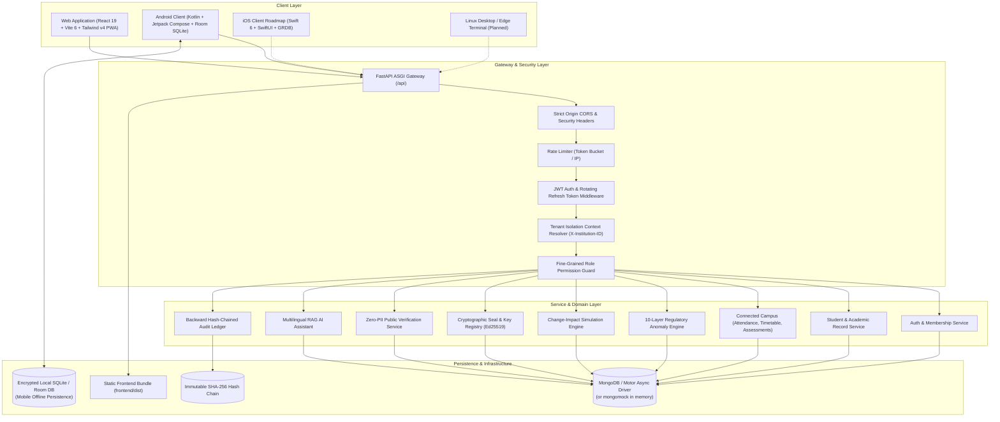
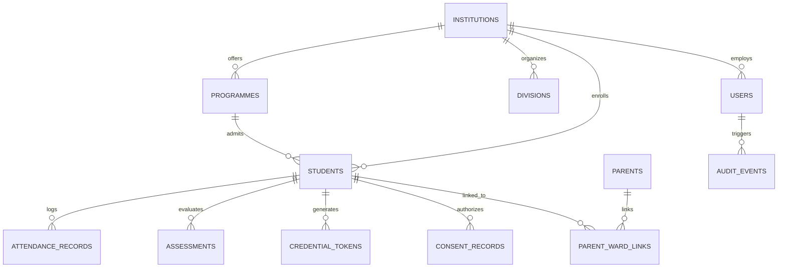
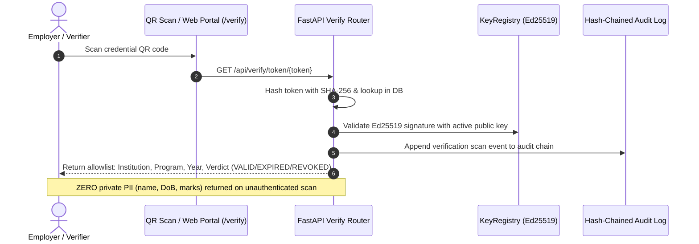
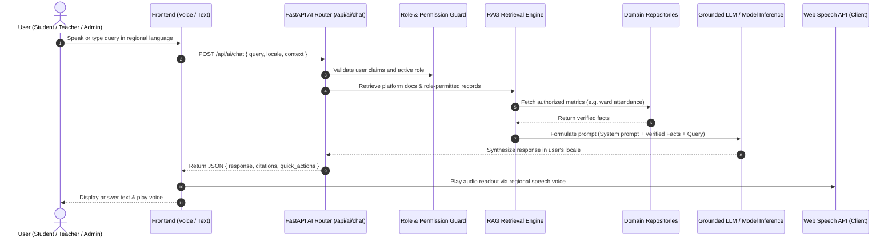

# ChhatraLekha — System Architecture & Technical Specification

**Document Version:** 2.1.0  
**Authority:** Mandatory Core Governance Document 3 of 4  
**Status:** Canonical Source of Truth  
**Repository:** [ChhatraLekha](https://github.com/kumaribaishnabidas/ChhatraLekha.git)  
**Last Updated:** 2026-11-23  

---

## 1. System Overview & Architectural Topology

**ChhatraLekha** is structured as an enterprise-grade modular monolith serving schools, colleges, polytechnics, universities, students, parents, and regulatory directorates across India.

The architecture emphasizes:
1. **Unified Multi-Tenancy:** A single extensible domain model serving both K-12 school divisions and collegiate departments.
2. **Offline-Resilient Edge Clients:** Native Android mobile apps and web progressive web apps (PWA) with two-way cryptographic synchronization.
3. **Cryptographic Trust & Zero-PII Public Validation:** Asymmetric digital signatures (Ed25519) and hash-chained audit logging ensuring tamper evidence without exposing student personal data.
4. **Strict Tenant & Role Scoping:** Defense-in-depth authorization preventing cross-institutional data leakage.

### 1.1 Architecture Diagram



---

## 2. Technology Stack & Verified Versions

### 2.1 Backend Platform (`chhatralekha/`)
- **Runtime:** Python 3.12+ (tested & verified on Python 3.14.2 AMD64).
- **Web Framework:** FastAPI `0.162.2` on Starlette `1.10.0` with ASGI server Uvicorn `0.32.0`.
- **Validation & Schemas:** Pydantic v2 `2.9.2` and Pydantic-Settings `2.7.1`.
- **Database Driver:** Motor `3.7.1` (async MongoDB client) backed by PyMongo `4.19.0`.
- **In-Memory Testing & Demo:** `mongomock-motor 0.0.35` (enables zero-dependency local testing and ephemeral demo mode via `ALLOW_IN_MEMORY_DB=true`).
- **Cryptography & Security:** `cryptography 50.0.2` (Ed25519 asymmetric signatures), `PyJWT 2.15.1`, `bcrypt 4.2.0`, `passlib 1.7.4`.
- **Utility & Media:** `reportlab 4.2.5` (PDF certificate generation), `qrcode[pil] 7.4.2`, `Pillow 13.0.0`, `Jinja2 3.1.6`, `httpx 0.27.2`.
- **Testing & Quality:** Pytest `9.2.0`, `pytest-asyncio 1.4.1`, Ruff `0.7.2`.

### 2.2 Web Frontend Platform (`frontend/`)
- **Runtime:** Node.js `v24.x` / npm `v11.x`.
- **Framework:** React `19.0.0` and React DOM `19.0.0`.
- **Build Tooling:** Vite `6.0.7` with `@vitejs/plugin-react 4.3.4`.
- **Styling & CSS:** Tailwind CSS `v4.0.0` (`@tailwindcss/vite 4.0.0`) with native CSS variable design tokens.
- **Routing:** React Router DOM `7.1.1`.
- **Data Visualization:** Recharts `3.10.1`.
- **Localization:** `i18next 26.5.4`, `react-i18next 17.1.0`, `i18next-browser-languagedetector 8.2.1`.
- **Typography:** Bundled `@fontsource/noto-sans-*` across all 22 Eighth Schedule Indian scripts.
- **Testing & Quality:** Vitest `5.1.0`, `@testing-library/react 16.1.0`, JSDOM `25.0.1`.

### 2.3 Mobile & Native Platforms
- **Android Client (`android/`):**
  - Language: Kotlin `2.2`.
  - UI Toolkit: Jetpack Compose with Material 3.
  - Local Storage: Android Jetpack Room with SQLite (`ApaarDatabase`).
  - Network Client: Pure Java standard `HttpURLConnection` (zero heavy external networking dependencies).
  - Sync & Background: Android WorkManager and custom `SyncManager.kt`.
- **iOS Client (`ios/`):**
  - Architecture: Documented in `docs/IOS_ARCHITECTURE_AND_ROADMAP.md`.
  - Target Stack: Swift 6, SwiftUI, GRDB.swift (SQLite), CryptoKit.
- **Linux Desktop Client (Planned):**
  - Lightweight offline institutional edge terminal container (Tauri/Rust or Compose Multiplatform).

---

## 3. Backend Architecture

### 3.1 API Structure & Router Topology
The backend mounts 24 modular routers under the `/api` prefix:

```
chhatralekha/app/api/
├── academic.py        # K-12 and collegiate academic structures, streams, programmes
├── ai.py              # Multilingual RAG assistant queries & prompt recommendations
├── announcements.py   # Targeted campus broadcast notices (students, parents, teachers)
├── anomalies.py       # 10-layer anomaly cases, assignment, notes, dismissal
├── assessments.py     # Continuous internal assessments, draft marks, moderation
├── attendance.py      # Period and daily attendance sessions, roll-call marking
├── auth.py            # Login, rotating refresh tokens, me, logout, demo logins
├── consent.py         # DPDP student consent records, grant/revoke actions
├── corrections.py     # Student record correction workflows
├── dashboard.py       # National and institutional overview metrics
├── deps.py            # FastAPI dependency injection (DB, User, RBAC, Tenant)
├── institutions.py    # Institution registry, capacity, self-registration
├── me.py              # Student self-service wallet, claim code, results, ID card
├── onboarding.py      # Institution and academic onboarding wizards
├── parent.py          # Guardian ward linkage, attendance roll-up, parent view
├── profile.py         # User profile management, password updates
├── reports.py         # Tabular data exports, regulatory compliance reports
├── schools.py         # K-12 specific classes, divisions, sections
├── students.py        # Student CRUD, status updates, batch CSV upload
├── teacher.py         # Teacher workspace, daily timetable, assigned sections
├── tokens.py          # Opaque verification token generation and management
├── transfers.py       # Inter-institutional student transfer request & release
├── transparency.py    # Public sustainability and statutory compliance metrics
└── verify.py          # Zero-PII public verification and JWKS public keys
```

### 3.2 Service Layer Design
Services encapsulate all core business logic and regulatory rules, completely decoupled from HTTP transport:
- `apaar_validator.py`: Canonical Indian 12-digit student identifier check digit and format validation.
- `anomaly_engine.py`: 10-layer regulatory rules verifying intake caps, supernumerary quotas, and duplicate enrollments.
- `impact_engine.py`: Pre-mutation simulation analyzing downstream capacity impacts and flagging credentials for reissue.
- `seal.py` & `key_registry.py`: Ed25519 asymmetric signing, HMAC-SHA256 seals, and versioned key rotation.
- `qr.py`: Opaque verification QR generation and payload construction.
- `csv_ingestion.py`: High-throughput batch streaming parser with row-level error isolation.
- `ai_assistant.py`: Permission-scoped retrieval engine answering queries in 22 languages.
- `audit_chain.py`: Cryptographic hash chain validator ensuring backward log continuity.

### 3.3 Database Access & Repository Pattern
Data mutations and queries are orchestrated through dedicated repository classes in `chhatralekha/app/repositories/`:
- `UserRepository`, `StudentRepository`, `InstitutionRepository`, `ProgrammeRepository`, `AttendanceRepository`, `AssessmentRepository`, `AuditRepository`, `TokenRepository`.
- **Strict Architectural Invariant:** Routers must never execute raw MongoDB queries directly. All database access must pass through the repository layer with tenant scoping parameters injected.

### 3.4 Student Academic Context Architecture & Validation
The student demo onboarding flow models both K-12 school and collegiate academic structures:
- **School Hierarchy:** `Institution (SCH-*)` -> `Classes (Class 8-12)` -> `Sections (A, B, Science-A)`.
- **College Hierarchy:** `Institution (INST-*)` -> `Programmes (B.Tech, MCA, MBA)` -> `Semesters (Semester 1-8)`.
- **Context Retrieval:** `GET /api/auth/demo-academic-context` exposes supported institutions and configured classes/programs.
- **Server-Side Validation:** `POST /api/auth/demo-login` validates requested institution, class/program, and semester/section against institutional catalogs before issuing credentials. Nonexistent or mismatched combinations are rejected with HTTP 404/400.
- **Profile Provisioning:** On valid selection, the system links or upserts a realistic synthetic student profile matching the academic grade level, roll number, and institution ID, preserving tenant isolation.

### 3.5 Master Institute ERP Architecture & Integration Model
The unified ERP expansion is detailed in [`docs/erp/INSTITUTE-ERP-INTEGRATION-ARCHITECTURE.md`](docs/erp/INSTITUTE-ERP-INTEGRATION-ARCHITECTURE.md):
- **Core Monolith Preservation:** All 11 ERP functional domains (Admissions, Academics, Faculty, Attendance, Examinations, Documents, Forms, Reporting, Portals, Workflows, Communication) reside inside the FastAPI modular monolith and share the single async MongoDB persistence layer.
- **Tenant Scope Enforcement:** All operations enforce `Principal.require_scope(institution_id)`. Cross-institution requests fail closed with HTTP 403.
- **Admission Promotion Pipeline:** Processing join requests atomically provisions student documents, marks APAAR records, and logs non-repudiable audit events.

---

## 4. Frontend Architecture

### 4.1 Component Structure
```
frontend/src/
├── components/
│   ├── cards/          # MetricCard, AnomalyCard, StudentCard, VerificationCard
│   ├── common/         # Button, Input, Modal, Badge, Toast, Spinner, CopyButton
│   ├── layout/         # AppLayout (Authenticated Shell), PublicLayout (Landing & Docs)
│   ├── nav/            # Header, MobileDrawer, LanguageSwitcher, ThemeToggle
│   └── voice/          # VoiceDrawer, AudioPlayer, SpeechRecognitionHook
├── context/            # AuthContext, ThemeContext, TenantContext
├── hooks/              # useAuth, useTheme, useDebounce, useVoice
├── i18n/               # Language definitions & 22 JSON translation catalogues
├── pages/              # 29 lazy-loaded application pages
│   └── student/        # Dedicated student self-service views
├── services/           # api.js (Axios instance, interceptors, base URLs)
└── utils/              # format.js, permissions.js, validators.js
```

### 4.2 Routing & Navigation Flow
React Router DOM v7 manages routing with three layers of route protection:
1. `Protected`: Ensures user possesses a valid, unexpired session token. Unauthenticated users are redirected to `/login` with return state.
2. `Guarded`: Validates fine-grained permissions against the user's role and membership context. Insufficient permissions render an accessible permission-denied alert.
3. `RoleRedirect`: Directs users to their default operational home based on role (`student` -> `/me`, `parent` -> `/parent`, `teacher` -> `/teacher`, `school_admin` -> `/school`, `college_admin` -> `/college`, `university_admin` / `aicte_admin` -> `/dashboard`).

---

## 5. Database Architecture & Collections

### 5.1 Primary Collections Schema Overview



### 5.2 Collection Specifications
1. **`institutions`**: Canonical profile, AISHE/DISE codes, affiliation board, type (`school`, `college`, `university`), sanctioned capacities, verification status.
2. **`programmes`**: Degrees/curricula, departments, academic years, sanctioned intake quotas, supernumerary quotas (TFWS, EWS, Sports).
3. **`divisions`**: School classes, grades, sections, assigned class teachers, timetable matrix.
4. **`students`**: Masked APAAR ID, academic details, enrolled institution, current status (`ADMITTED`, `ACTIVE`, `ON_LEAVE`, `TRANSFERRED`, `GRADUATED`), record version (`version`).
5. **`attendance_sessions`**: Session metadata, date, period, division, marked by teacher ID, array of student attendance statuses (`PRESENT`, `ABSENT`, `LATE`, `EXCUSED`).
6. **`assessments`**: Subject, evaluation type (unit test, practical, term exam), maximum marks, student score array, moderation lock status.
7. **`tokens`**: Opaque 64-character verification tokens, hash, student APAAR reference, allowed disclosure fields, expiration date, revoked flag.
8. **`audit_events`**: Append-only log with backward hash chaining (`prev_hash`, `timestamp`, `actor`, `action`, `subject`, `details`, `category`).
9. **`refresh_tokens`**: Active refresh tokens stored as SHA-256 digests with `jti` lineage and family IDs for automatic rotation invalidation.
10. **`consents`**: DPDP compliance logs, consent purpose, granted by (student or parent), granted date, status (`ACTIVE`, `REVOKED`).

---

## 6. Security Architecture & Tenant Isolation

### 6.1 Tenant Isolation Protocol
Every user interaction with institutional data is bounded by an `institution_id`:
- Non-operator users have their active `institution_id` resolved directly from their authenticated JWT token memberships.
- Clients supply `X-Institution-ID` when switching between authorized institutions.
- The `deps.get_tenant_context` dependency verifies membership before passing control to routers.
- Cross-tenant queries are blocked with HTTP 403 Forbidden.

### 6.2 Asymmetric Credential Verification Flow



### 6.3 Public API Documentation Access Control & Gateway Hardening
To prevent OpenAPI schema and route exposure in production:
- **Configuration Tri-State:** Settings attribute `enable_docs: bool | None = None` (with `docs_enabled` alias).
  - Production (`is_production == True`): Defaults to `False`. Docs endpoints are suppressed (`docs_url=None`, `redoc_url=None`, `openapi_url=None`).
  - Development (`is_production == False`): Defaults to `True`. Full interactive Swagger UI and ReDoc are available.
  - Staging Override: Setting `ENABLE_DOCS=true` re-enables docs on isolated internal deployments.
- **Application Factory Pattern:** `create_app(app_settings: Settings | None = None) -> FastAPI` instantiates the application dynamically with active settings.
- **SPA Fallback Interception:** The catch-all SPA route `/{full_path:path}` explicitly rejects requests to `docs`, `redoc`, and `openapi.json` with HTTP 404 when documentation is disabled, preventing unhandled route fallthrough to `index.html`.
- **Information Disclosure Prevention:** The 503 `frontend_missing` error handler omits `"api": "/docs"` when documentation is disabled.

---

## 7. AI & RAG Architecture



### 7.1 Grounding & Privacy Safeguards
- The AI assistant is strictly grounded in official platform documentation, institutional guidelines, and user-authorized database records.
- Hallucination Policy: Queries asking for unrecorded metrics return clear clarification rather than synthetic facts.
- Data Security: Student records are never exposed across user boundaries.

---

## 8. Deployment Architecture: Current vs. Proposed

### 8.1 Approved Current Deployment Architecture (Modular Monolith)
The canonical production deployment architecture is a **Unified Modular Monolith**:
- **Backend Service:** A single containerized FastAPI ASGI application (`chhatralekha/Dockerfile`) serving the REST API.
- **Frontend Distribution:** Single-page application built via Vite into `frontend/dist`. Can be served directly by FastAPI or deployed to Vercel via [`frontend/vercel.json`](file:///C:/Users/BAISHNABI/.gemini/antigravity/scratch/ChhatraLekha/frontend/vercel.json).
- **Backend Cloud Spec:** Configured for Render via [`render.yaml`](file:///C:/Users/BAISHNABI/.gemini/antigravity/scratch/ChhatraLekha/render.yaml) using Python 3.12/3.14.
- **Local Dev / Single Command:** Orchestrated via [`docker-compose.yml`](file:///C:/Users/BAISHNABI/.gemini/antigravity/scratch/ChhatraLekha/docker-compose.yml) hosting MongoDB and the API.

> [!IMPORTANT]
> **Architectural Decision:** An experimental multi-service microservices configuration was explored in historical drafts. It has **NOT** been approved or adopted for production. The authoritative production architecture remains the **Modular Monolith** to prevent operational overhead, data consistency lag, and unnecessary infrastructure costs.

---

## 9. Mobile & Edge Architecture

### 9.1 Android Offline Outbox (`android/`)
- Persistent SQLite cache managed via Jetpack Room (`ApaarDatabase`).
- Offline changes queued in `pending_sync` with unique client UUIDs (`sync_id`).
- Pure Java standard HTTP client (`ChhatraLekhaApiClient.kt`) pushes batches to `/api/sync/push`.
- HTTP 409 Conflict triggers client reconciliation when concurrent edits occur.
- Ed25519 public key bundled locally to verify QR credentials completely offline.

### 9.2 Native iOS Roadmap (`ios/` & `docs/IOS_ARCHITECTURE_AND_ROADMAP.md`)
- Swift 6 + SwiftUI client matching the Android offline outbox pattern using GRDB.swift SQLite, Keychain token storage, and CryptoKit Ed25519 validation.

### 9.3 Linux Desktop / Edge Institutional Terminal
- Planned lightweight web container (Tauri/Rust or Compose Multiplatform) providing edge attendance recording for rural schools with zero broadband connectivity.

---

## 10. Architecture Decision Records (ADRs)

All architectural decisions are formally recorded in `docs/adr/`:
1. **ADR-001 (Rule Packs Architecture):** Establishes canonical JSON rule test fixtures preventing validation drift between Python backend and Kotlin Android engines.
2. **ADR-002 (Academic Unit Abstraction):** Unifies K-12 grade divisions and collegiate departments into a shared academic unit hierarchy.
3. **ADR-003 (Institution Identifiers Model):** Harmonizes AISHE, UDISE+, and AICTE codes into a structured institutional identifier schema.
4. **ADR-004 (Guardian Role & Minor DPDP Consent):** Establishes verified parent-child links and DPDP Act 2023 compliance for minor students.

---

## 11. Architectural Invariant Rules

1. **No Monolith Fragmentation:** Do not split the backend into separate repositories or microservices without an approved ADR.
2. **No Direct Database Bypass:** All database mutations must flow through repository interfaces with tenant scoping parameters.
3. **No Unkeyed Seals:** Plain SHA-256 digests are deprecated. All credentials must be signed with Ed25519 or HMAC-SHA256.
4. **Rule Synchronization:** Any modification to regulatory validation rules must update both `chhatralekha/app/resources/rule_test_fixtures.json` and `android/core/src/test/resources/rule_test_fixtures.json`.
