# ChhatraLekha — Product Requirements Document (PRD)

**Document Version:** 2.1.0  
**Authority:** Mandatory Core Governance Document 1 of 4  
**Status:** Canonical Source of Truth  
**Repository:** [ChhatraLekha](https://github.com/kumaribaishnabidas/ChhatraLekha.git)  
**Last Updated:** 2026-11-23  

---

## 1. Product Identity, Vision, and Mission

### 1.1 Product Name
**ChhatraLekha** (छात्रलेखा) — *Unified Student Academic Identity & Campus Platform for Schools and Colleges Across India*.

### 1.2 Product Vision
> **"One Platform. Every Institution. Every Learner. Every Indian Language."**  
> To establish a tamper-evident, accessible, multilingual digital academic identity and connected campus operating system that anchors every Indian student's lifelong academic journey from primary school through higher education, polytechnics, and universities.

### 1.3 Mission
Provide educational institutions, learners, faculty, families, and regulatory bodies across India with a secure, zero-friction, privacy-first software platform that unifies academic admissions, daily attendance, examination assessments, credential issuance, and inter-institutional mobility while adhering strictly to the Digital Personal Data Protection (DPDP) Act 2023 and national educational guidelines.

### 1.4 Problem Statement
1. **Fragmented Academic Systems:** Indian educational administration is divided between disconnected silos: K-12 school boards (CBSE, ICSE, State Boards) and diverse Higher Education Institutions (Colleges, Polytechnics, Universities). Data does not travel smoothly across levels.
2. **Credential Fraud & Verification Latency:** Manual paper transcripts, unkeyed PDFs, and unverified marksheets cause weeks of verification backlog for employers, embassies, and admissions officers while facilitating credential tampering.
3. **Linguistic & Accessibility Barriers:** Over 70% of Indian students and parents in rural and semi-urban communities struggle with English-only educational portals lacking native regional script typography, keyboard layouts, and voice assistance.
4. **Regulatory Non-Compliance & Inadvertent Over-Enrolment:** Institutions frequently struggle to monitor AICTE Approval Process Handbook (APH) sanctioned intake ceilings, supernumerary quotas (TFWS, EWS, Sports), and duplicate student enrollments in real time.
5. **Data Protection Vulnerabilities:** Traditional educational ERPs leak student personally identifiable information (PII) to third parties without granular consent or minor-guardian authorization under the Digital Personal Data Protection (DPDP) Act 2023.

### 1.5 Product Objectives
- **Zero-PII Public Verification:** Facilitate instant, tamper-evident credential verification via QR codes and cryptographic asymmetric seals without exposing student date of birth, marks, or personal contact info.
- **Unified Connected Campus Core:** Serve both K-12 schools and collegiate institutions through a single modular backend architecture with fine-grained role-based access control.
- **Complete Indian Linguistic Inclusion:** Deliver native support across all 22 Eighth Schedule Indian constitutional languages with dedicated typography and voice assistance.
- **Offline-Resilient Mobile Experience:** Enable teachers and students in intermittent connectivity zones to record attendance and verify credentials with automated cryptographic synchronization.
- **Regulatory Transparency & Integrity:** Detect anomalous intake breaches, duplicate enrollments, and academic record alterations with immutable hash-chained audit logging.

### 1.6 Statutory Disclaimer
ChhatraLekha is an independent educational technology prototype platform. Nothing in this platform constitutes an official government registry, and ChhatraLekha does not issue official statutory APAAR, AICTE, CBSE, or government registry credentials autonomously without authorized government integration.

---

## 2. Target Users, Institutions, and Stakeholder Ecosystem

ChhatraLekha is built specifically for the multi-tier Indian education ecosystem:

### 2.1 Target Institutions
1. **K-12 Primary and Secondary Schools:** Government schools, Kendriya Vidyalayas (KV), Navodaya Vidyalayas (JNV), Private CBSE/ICSE schools, and State Board schools.
2. **Polytechnic & Diploma Institutes:** State technical boards, vocational colleges, and industrial training institutes (ITIs).
3. **Undergraduate & Postgraduate Colleges:** Affiliated engineering colleges, medical institutes, management colleges, autonomous arts and science colleges.
4. **Universities:** State universities, Central universities, Private universities, Deemed-to-be universities.
5. **Regulatory & Directorate Bodies:** AICTE, State Higher Education Councils, State Directorates of Technical Education, School Education Departments.

### 2.2 User Personas & System Roles

| User Persona | System Role | Context & Key Workflows |
|---|---|---|
| **Student** | `student` | High school students, polytechnic diploma learners, undergraduate and postgraduate scholars. Accesses digital wallet, views timetable/attendance, grants time-limited document shares, and chats with the multilingual assistant. |
| **Parent / Guardian** | `parent` | Guardians of minor school students or college dependents. Monitors ward's daily attendance records, views report cards, receives school bulletins, and authorizes DPDP data consent. |
| **Teacher / Faculty** | `teacher` | School subject teachers, college lecturers, and professors. Conducts session attendance marking, inputs marks and grading rubrics, publishes assignments, and issues student advisory notes. |
| **School Administrator** | `school_admin` | Headmasters, principals, and administrative staff at K-12 schools. Manages grade divisions, academic calendars, teacher timetable allocations, and student enrollment registers. |
| **College Administrator** | `college_admin` | College principals, deans, and registrar staff at undergraduate/polytechnic colleges. Enforces departmental intake caps, handles bulk CSV admissions, and reviews anomalous submissions. |
| **University Administrator** | `university_admin` | Registrars, controllers of examinations, and academic council members. Oversees affiliated colleges, manages state-wide exam sessions, and inspects cross-college transfers. |
| **Government / Regulatory** | `aicte_admin` / `platform_operator` | AICTE directors, state higher education officers, and platform operators. Audits intake quotas, monitors regulatory compliance, inspects cryptographic chains, and administers institution licenses. |
| **Public Verifier** | `verifier` / Unauthenticated | Employers, background verification agencies, embassies, and admissions officers. Scans QR codes and validates opaque verification tokens with zero access to private PII. |

---

## 3. Product Scope, Boundaries, and Feature Status

Every feature in ChhatraLekha is strictly classified into one of six verified operational states:
1. **Implemented and verified:** Functional in code, passing automated tests in CI.
2. **Implemented but not fully verified:** Code exists in repository, but requires end-to-end multi-platform integration verification.
3. **Partially implemented:** Partial feature present (e.g., frontend component exists, backend API mock/stubbed).
4. **Planned:** Formally specified in architecture or roadmaps, scheduled for upcoming release cycles.
5. **Experimental:** Proof-of-concept implementation active in isolated prototypes (e.g., client-side OCR, offline vector search).
6. **Deprecated:** Legacy implementations retired in favor of newer secure standards.

### 3.1 Feature Classification Matrix

| Feature Area | Sub-Feature / Capability | Classification Status | Implementation Reference |
|---|---|---|---|
| **Authentication & Access** | Multi-Role JWT Auth + Stateful Refresh Rotation | **Implemented and verified** | `chhatralekha/app/api/auth.py`, `chhatralekha/app/core/security.py` |
| | Ephemeral Single-Click Demo Personas | **Implemented and verified** | `chhatralekha/app/api/auth.py`, `frontend/src/components/common/DemoGuide.jsx` |
| | Student Academic Onboarding Wizard (School & College) | **Implemented and verified** | `chhatralekha/app/schemas/auth.py`, `frontend/src/components/common/StudentAcademicSelectionWizard.jsx` |
| | Public FastAPI Documentation Access Control | **Implemented and verified** | `chhatralekha/app/core/config.py`, `chhatralekha/app/main.py`, `chhatralekha/tests/test_docs_security.py` |
| | Fine-Grained Tenant & Role Scoping (RBAC) | **Implemented and verified** | `chhatralekha/app/core/rbac.py`, `docs/security/permission-matrix.md` |
| **Identity & Credentials** | APAAR ID Validation & Checksum Verification | **Implemented and verified** | `app/services/apaar_validator.py`, `android/core/.../ApaarValidator.kt` |
| | Masked Identifier Display (`****-****-0001`) | **Implemented and verified** | `frontend/src/utils/format.js`, `frontend/src/test/DesignLint.test.jsx` |
| | Printable Digital ID Card with QR & Barcode | **Implemented and verified** | `frontend/src/pages/student/StudentIdCardPage.jsx`, `app/services/qr.py` |
| | Opaque Time-Limited Verification Tokens | **Implemented and verified** | `chhatralekha/app/api/tokens.py`, `chhatralekha/app/api/verify.py` |
| | Cryptographic Seals (HMAC-SHA256 & Ed25519) | **Implemented and verified** | `chhatralekha/app/services/seal.py`, `app/services/key_registry.py` |
| | Unkeyed SHA-256 Legacy Seals | **Deprecated** | Flagged as `LEGACY_UNVERIFIED` in `seal.py` (Never accepted for auth) |
| **Student Self-Service** | Single-Use Hashed Claim Code Onboarding | **Implemented and verified** | `chhatralekha/app/api/me.py` (`/api/me/claim`), `frontend/src/pages/student/` |
| | Granular Field-Disclosed Share Links | **Implemented and verified** | `frontend/src/pages/student/StudentSharePage.jsx`, `/api/me/shares` |
| | Revocable Consent Ledger & DPDP Compliance | **Implemented and verified** | `frontend/src/pages/student/StudentConsentPage.jsx`, `/api/consent` |
| | Academic Results & SGPA/CGPA Analytics | **Implemented and verified** | `frontend/src/pages/student/StudentResultsPage.jsx`, `/api/me/results` |
| | Student Activity & Audit History | **Implemented and verified** | `frontend/src/pages/student/StudentActivityPage.jsx`, `/api/me/activity` |
| **Academic Operations** | Configurable Multi-Tenant Core (K-12 & Higher Ed) | **Implemented and verified** | `chhatralekha/app/api/academic.py`, `ADR-002-academic-unit-abstraction.md` |
| | Timetable & Schedule Management | **Implemented and verified** | `/api/academic/timetable`, `/api/teacher/timetable` |
| | Period-wise & Daily Student Attendance | **Implemented and verified** | `chhatralekha/app/api/attendance.py`, `frontend/src/pages/AttendancePage.jsx` |
| | Teacher Classroom Workspace | **Implemented and verified** | `chhatralekha/app/api/teacher.py`, `frontend/src/pages/TeacherWorkspacePage.jsx` |
| | Continuous Internal Assessments & Moderation | **Implemented and verified** | `chhatralekha/app/api/assessments.py`, `frontend/src/pages/AssessmentsPage.jsx` |
| | Targeted Campus Announcements | **Implemented and verified** | `chhatralekha/app/api/announcements.py`, `frontend/src/pages/AnnouncementsPage.jsx` |
| | Guardian-Ward Association & Verification | **Implemented and verified** | `chhatralekha/app/api/parent.py`, `frontend/src/pages/ParentPortalPage.jsx` |
| | Inter-Institutional Student Transfers | **Implemented and verified** | `chhatralekha/app/api/transfers.py`, Relieving/Receiving Institution Flow |
| **Regulatory & Integrity** | 10-Layer Anomaly Engine (APH Quotas & Duplicates) | **Implemented and verified** | `app/services/anomaly_engine.py`, `android/core/.../AnomalyEngine.kt` |
| | Batch CSV Ingestion with Row Error Isolation | **Implemented and verified** | `app/services/csv_ingestion.py`, `frontend/src/pages/UploadPage.jsx` |
| | Academic Record Change-Impact Simulation | **Implemented and verified** | `app/services/impact_engine.py`, `frontend/src/pages/ImpactPage.jsx` |
| | Immutable Hash-Chained Audit Ledger | **Implemented and verified** | `app/audit/writer.py`, `app/services/audit_chain.py` (`/api/audit/verify-chain`)|
| | Sustainability & Transparency Charter | **Implemented and verified** | `chhatralekha/app/api/transparency.py`, `frontend/src/pages/TransparencyPage.jsx`|
| **AI & Multilingual** | Multilingual UI (22 Indian Scheduled Languages) | **Implemented and verified** | `frontend/src/i18n/`, `scripts/i18n-check.mjs` (441 keys validated) |
| | Browser Web Speech TTS Audio Playback | **Implemented and verified** | `frontend/src/voice/tts.js`, `frontend/src/components/common/VoiceDrawer.jsx` |
| | Grounded Role-Aware AI Assistant (RAG) | **Implemented but not fully verified**| `chhatralekha/app/api/ai.py` (Functional with mocked external vector DB) |
| | Client-Side Document OCR Extraction | **Experimental** | Basic Tesseract/Canvas hook in frontend; robust pipeline planned |
| | Neural Offline STT (Bhashini API Integration) | **Planned** | Native Bhashini API integration slated for Stage 1.2 |
| **Platforms & Native** | Progressive Web App (PWA) Client | **Implemented and verified** | React 19, Vite 6, Tailwind CSS 4, service worker manifest |
| | Native Android Client (Kotlin / Compose / Room) | **Implemented and verified** | Offline SQLite caching, `SyncManager.kt`, Ed25519 QR validation |
| | Native iOS Client (Swift 6 / SwiftUI / GRDB) | **Planned (Spec Complete)** | Architecture approved in `docs/IOS_ARCHITECTURE_AND_ROADMAP.md` |
| | Linux Desktop Client (Offline Institutional Edge) | **Planned** | Lightweight Tauri/Rust or Compose Multiplatform container planned Stage 2 |

---

## 4. Functional Requirements

Each requirement is assigned a permanent identifier (`PRD-F-xxx`).

### PRD-F-001: Multi-Role Authentication with Rotating Refresh Tokens
- **User:** All authenticated users (`student`, `parent`, `teacher`, `school_admin`, `college_admin`, `university_admin`, `aicte_admin`).
- **Expected Behavior:** System validates user credentials using bcrypt, issues a short-lived access JWT (15-60 min), and a stateful cryptographically hashed refresh token (7 days). On token refresh, the old refresh token is invalidated and a new pair is issued (token family rotation).
- **Priority:** P0 (Critical).
- **Status:** Implemented and verified.
- **Acceptance Criteria:**
  1. Failed logins return generic 401 Unauthorized without exposing whether the email or password was invalid.
  2. Refresh token reuse triggers immediate family revocation and logs a security incident.
  3. Server-side logout revokes active refresh tokens immediately.
- **Related Modules:** `chhatralekha/app/api/auth.py`, `chhatralekha/app/core/security.py`, `frontend/src/hooks/useAuth.js`.
- **Related Tests:** `chhatralekha/tests/test_auth.py`, `frontend/src/test/useAuth.test.jsx`.

### PRD-F-002: Tenant Scoping and Cross-Institution Isolation
- **User:** Institutional staff and students.
- **Expected Behavior:** All queries and mutations for institutional data must resolve and validate against the user's active `institution_id`. No user can query or alter data belonging to another institution unless possessing `platform_operator` or `aicte_admin` privileges.
- **Priority:** P0 (Critical).
- **Status:** Implemented and verified.
- **Acceptance Criteria:**
  1. Requests missing `institution_id` where required are rejected with HTTP 400.
  2. Attempting to access foreign institution IDs returns HTTP 403 Forbidden.
  3. Unit tests verify zero cross-tenant leakage.
- **Related Modules:** `chhatralekha/app/core/rbac.py`, `chhatralekha/app/api/deps.py`.
- **Related Tests:** `chhatralekha/tests/test_rbac.py`, `chhatralekha/tests/test_tenant_isolation.py`.

### PRD-F-003: APAAR Identifier Validation & Checksum Verification
- **User:** Students, Teachers, Administrators, CSV Ingestion engine.
- **Expected Behavior:** Validates 12-digit Indian student APAAR identifiers according to canonical Verhoeff/Luhn checksum algorithm and standard syntax checks.
- **Priority:** P0 (Critical).
- **Status:** Implemented and verified.
- **Acceptance Criteria:**
  1. Validates length (12 digits), numeric syntax, and algorithmic check digit.
  2. Backend and Android core validators yield 100% identical outputs against shared test fixtures.
  3. Masked formatting (`****-****-1234`) is mandatory in all user interfaces.
- **Related Modules:** `chhatralekha/app/services/apaar_validator.py`, `android/core/.../ApaarValidator.kt`.
- **Related Tests:** `chhatralekha/tests/test_apaar_validator.py`, `android/core/.../ApaarValidatorTest.kt`.

### PRD-F-004: 10-Layer Regulatory Anomaly Detection Engine
- **User:** Institutional Administrators, Directorate Officers.
- **Expected Behavior:** Real-time analysis of student admission records against regulatory constraints:
  - Layer 1: APAAR syntax & check digit.
  - Layer 2: Intra-institutional duplicate APAAR.
  - Layer 3: Inter-institutional cross-enrollment collision.
  - Layer 4: Duplicate roll numbers within the same academic program.
  - Layer 5: Sanctioned intake capacity ceiling breach.
  - Layer 6: Supernumerary quota caps (e.g., TFWS, EWS, Sports, J&K).
  - Layer 7: Category quota conflicts.
  - Layer 8: Date of birth & admission chronometry anomalies.
  - Layer 9: Mandatory field omissions.
  - Layer 10: Unapproved programme/curriculum offerings.
- **Priority:** P0 (Critical).
- **Status:** Implemented and verified.
- **Acceptance Criteria:**
  1. Synthetic evaluation suite achieves 100% precision and 100% recall on reference datasets.
  2. Detected anomalies generate structured review cases with severity, affected counts, and suggested remediations.
- **Related Modules:** `chhatralekha/app/services/anomaly_engine.py`, `android/core/.../AnomalyEngine.kt`.
- **Related Tests:** `chhatralekha/tests/test_anomalies.py`, `eval_anomalies.py`.

### PRD-F-005: Academic Record Change-Impact Simulation
- **User:** Institutional Principals, Regulatory Reviewers.
- **Expected Behavior:** Before modifying an active student record or batch of records, the system generates an impact preview detailing downstream effects: intake cap violations, quota recalculations, and affected digital credentials that will require re-issuance.
- **Priority:** P1 (High).
- **Status:** Implemented and verified.
- **Acceptance Criteria:**
  1. `POST /api/impact/preview` returns a structured diff with severity categorization.
  2. `POST /api/impact/apply` executes mutations atomically, marks affected credentials as `NEEDS_REFRESH`, and writes to the audit chain.
- **Related Modules:** `chhatralekha/app/services/impact_engine.py`, `frontend/src/pages/ImpactPage.jsx`.
- **Related Tests:** `chhatralekha/tests/test_impact.py`.

### PRD-F-006: Asymmetric Cryptographic Credential Issuance
- **User:** Authenticated Institution Admin, Graduated Students.
- **Expected Behavior:** Digital academic credentials (marksheets, completion certificates, student IDs) are signed using server-held Ed25519 private keys. Public keys are exposed via standard JWKS (`/api/verify/jwks`) and PEM format (`/api/verify/public-key`).
- **Priority:** P0 (Critical).
- **Status:** Implemented and verified.
- **Acceptance Criteria:**
  1. Third-party verifiers can validate credential seals completely offline using the public key.
  2. Revoked keys immediately fail validation.
- **Related Modules:** `chhatralekha/app/services/seal.py`, `chhatralekha/app/services/key_registry.py`.
- **Related Tests:** `chhatralekha/tests/test_seal.py`.

### PRD-F-007: Zero-PII Public Token Verification
- **User:** Employers, Background Verifiers, General Public.
- **Expected Behavior:** Verifiers scan a student's credential QR code or enter an opaque 64-character token at `/verify`. System resolves the token and returns strictly non-sensitive academic attributes: Institution Name, Program, Academic Year, and Verdict (`VALID`, `EXPIRED`, `REVOKED`, `NEEDS_REFRESH`).
- **Priority:** P0 (Critical).
- **Status:** Implemented and verified.
- **Acceptance Criteria:**
  1. Under no circumstances are student name, Aadhaar, APAAR ID, date of birth, or marks exposed on the unauthenticated public endpoint.
  2. Expired, revoked, or refresh-pending credentials display prominent visual warnings.
- **Related Modules:** `chhatralekha/app/api/verify.py`, `frontend/src/pages/TokenVerificationPage.jsx`.
- **Related Tests:** `chhatralekha/tests/test_verify.py`, `frontend/src/test/TokenVerificationPage.test.jsx`.

### PRD-F-008: Classroom Attendance Marking & Session Tracking
- **User:** Teachers (`teacher`).
- **Expected Behavior:** Teacher selects class division, subject, and time slot to mark daily or period attendance. Supports 1-click "Mark All Present", granular "Absent", "Late", "Excused" toggles, and instant offline caching.
- **Priority:** P1 (High).
- **Status:** Implemented and verified.
- **Acceptance Criteria:**
  1. Submissions generate immutable attendance sessions linked to teacher ID, division ID, and timestamp.
  2. Daily attendance rolls up to student and parent dashboards in real time.
- **Related Modules:** `chhatralekha/app/api/attendance.py`, `frontend/src/pages/AttendancePage.jsx`.
- **Related Tests:** `chhatralekha/tests/test_attendance.py`.

### PRD-F-009: Continuous Internal Assessment & Marks Moderation
- **User:** Teachers (`teacher`), Academic Admins (`academic_admin`).
- **Expected Behavior:** Teachers submit draft continuous assessment marks (class tests, practicals, mid-terms). Academic administrators review, moderate, and publish final locked scores.
- **Priority:** P1 (High).
- **Status:** Implemented and verified.
- **Acceptance Criteria:**
  1. Draft marks remain editable only by the authoring teacher until submitted for moderation.
  2. Approved marks become read-only and reflect on the student result portal.
- **Related Modules:** `chhatralekha/app/api/assessments.py`, `frontend/src/pages/AssessmentsPage.jsx`.
- **Related Tests:** `chhatralekha/tests/test_assessments.py`.

### PRD-F-010: Student Single-Use Claim Code Onboarding
- **User:** Newly enrolled students.
- **Expected Behavior:** Enrolled students receive a single-use hashed alphanumeric claim code from their institution. Entering the code at `/signup` binds the student's APAAR record to their verified user account.
- **Priority:** P1 (High).
- **Status:** Implemented and verified.
- **Acceptance Criteria:**
  1. Claim codes are salted and hashed at rest (SHA-256).
  2. Code expires after single use or after configurable timeout (e.g., 7 days).
- **Related Modules:** `chhatralekha/app/api/me.py`, `chhatralekha/app/api/students.py`.
- **Related Tests:** `chhatralekha/tests/test_student_claim.py`.

### PRD-F-011: Granular Consent & Field-Disclosed Share Links
- **User:** Students (`student`), Parents (`parent`).
- **Expected Behavior:** Students can create shareable links for their verified profile with granular field disclosure (e.g., disclose "Programme & Year", hide "CGPA" and "Attendance"). Links can be protected with an expiration time or revoked instantly.
- **Priority:** P1 (High).
- **Status:** Implemented and verified.
- **Acceptance Criteria:**
  1. Custom token verifies disclosed fields only; omitted fields return null.
  2. Revoking a share link renders subsequent visits immediately invalid.
  3. Action is recorded in student's consent ledger.
- **Related Modules:** `chhatralekha/app/api/consent.py`, `frontend/src/pages/student/StudentSharePage.jsx`.
- **Related Tests:** `chhatralekha/tests/test_consent.py`.

### PRD-F-012: Multilingual UI Across 22 Eighth Schedule Indian Languages
- **User:** All users.
- **Expected Behavior:** Instant language switching across 22 constitutional Indian languages without page reloads. Typography dynamically loads script-specific Noto Sans font families.
- **Priority:** P1 (High).
- **Status:** Implemented and verified.
- **Acceptance Criteria:**
  1. Zero untranslated placeholder text or fallback errors across core user journeys.
  2. Automated test `scripts/i18n-check.mjs` verifies key parity across all locales.
  3. RTL support for Urdu and Kashmiri.
- **Related Modules:** `frontend/src/i18n/`, `frontend/src/index.css`.
- **Related Tests:** `frontend/src/test/i18n.test.jsx`.

### PRD-F-013: Grounded Role-Aware Multilingual AI Assistant
- **User:** Authenticated students, parents, teachers, administrators.
- **Expected Behavior:** Provides conversational guidance on platform usage, attendance status, timetable schedules, and regulatory rules in the user's active language. Backed by role-filtered retrieval grounding.
- **Priority:** P2 (Medium).
- **Status:** Implemented but not fully verified.
- **Acceptance Criteria:**
  1. Zero hallucination: Questions regarding unrecorded data return clear clarification rather than synthetic facts.
  2. Assistant strictly respects RBAC and never surfaces peer student records or unauthorized institutional data.
- **Related Modules:** `chhatralekha/app/api/ai.py`, `chhatralekha/app/services/ai_assistant.py`, `frontend/src/components/common/VoiceDrawer.jsx`.
- **Related Tests:** `chhatralekha/tests/test_ai_assistant.py`.

### PRD-F-014: Inter-Institutional Student Mobility & Transfer Workflow
- **User:** College / School Administrators.
- **Expected Behavior:** Receiving institution submits a formal transfer request; relieving institution holds exclusive authority to approve release with full audit logging and institutional notifications.
- **Priority:** P1 (High).
- **Status:** Implemented and verified.
- **Acceptance Criteria:**
  1. Student status transitions to `TRANSFERRED` on release.
  2. Relieving institution loses mutation authority over active records.
- **Related Modules:** `chhatralekha/app/api/transfers.py`.
- **Related Tests:** `chhatralekha/tests/test_transfers.py`.

### PRD-F-015: Android Local SQLite Caching & Two-Way Sync
- **User:** Teachers and students on Android devices.
- **Expected Behavior:** Offline operations queued in `pending_sync` Room table. Pushed automatically on network availability with conflict resolution via HTTP 409 status code.
- **Priority:** P1 (High).
- **Status:** Implemented and verified.
- **Acceptance Criteria:**
  1. Record versions prevent silent overwrites.
  2. Local verification confirms Ed25519 signatures completely offline.
- **Related Modules:** `android/app/.../SyncManager.kt`, `android/core/.../SealVerification.kt`.
- **Related Tests:** `android/core/src/test/` (204 tests).

### PRD-F-016: Student Document Upload & Verification
- **User:** Students, Institutional Reviewers.
- **Expected Behavior:** Students upload certificates/transcripts. System stores document metadata and enables human-in-the-loop review.
- **Priority:** P2 (Medium).
- **Status:** Partially implemented (client upload functional, automated OCR backend verification pipeline in progress).
- **Acceptance Criteria:**
  1. Documents validated for MIME type and file size (< 10MB).
  2. Review status transitions: `PENDING` -> `VERIFIED` / `REJECTED`.
- **Related Modules:** `chhatralekha/app/api/me.py`, `frontend/src/pages/student/StudentUploadsPage.jsx`.
- **Related Tests:** `chhatralekha/tests/test_student_uploads.py`.

### PRD-F-017: Contextual Student Demo & Academic Onboarding Wizard
- **User:** Students (`student`), Evaluators, Prospective Learners.
- **Expected Behavior:** When entering the student demo or academic onboarding workflow, the user selects their education tier:
  - **Tier Choice:** "School Student" vs "College/University Student".
  - **School Flow:** User selects school institution, displays dynamic Class dropdown based strictly on the selected school's supported offerings (e.g. Class 8 through 12), and selects class section where applicable.
  - **College Flow:** User selects college institution, displays dynamic Course/Program dropdown (e.g. B.Tech CSE, MCA, MBA) with approved levels (UG/PG/Diploma), and selects active semester/year.
  - **Server-Side Context Validation:** Validates submitted academic values against institutional configurations; rejects cross-institution context manipulation with HTTP 404/400.
  - **Demo Persona Access:** Supports 1-click access across all 6 key personas (Student, Parent, Faculty, School Admin, College Admin, Directorate) with prominent synthetic demonstration labels.
- **Priority:** P1 (High).
- **Status:** Implemented and verified.
- **Acceptance Criteria:**
  1. Instant student login without context is superseded by the academic context selection modal.
  2. Classes and courses are populated strictly from institutional data models, never arbitrary static lists.
  3. Student profile (`/api/students/me`) correctly reflects the selected school grade or college course and semester.
  4. Client and server validation prevent enrollment in mismatched programs.
- **Related Modules:** `chhatralekha/app/schemas/auth.py`, `chhatralekha/app/api/auth.py`, `frontend/src/components/common/StudentAcademicSelectionWizard.jsx`, `frontend/src/components/common/DemoGuide.jsx`, `frontend/src/pages/LoginPage.jsx`.
- **Related Tests:** `chhatralekha/tests/test_demo_academic_context.py`, `frontend/src/test/StudentAcademicSelectionWizard.test.jsx`.

### PRD-F-018: FastAPI Public API Documentation Access Control
- **User:** Developers, Platform Operators, Security Auditors.
- **Expected Behavior:** Strict environment-aware access control over Swagger UI (`/docs`), ReDoc (`/redoc`), and OpenAPI schema (`/openapi.json`):
  - **Development Mode:** Documentation endpoints enabled by default for local development.
  - **Production Mode:** Documentation endpoints disabled by default (returning HTTP 404 Not Found), preventing schema and endpoint leakage.
  - **Staging / VPN Override:** Supports explicit configuration override via `ENABLE_DOCS=true` or `DOCS_ENABLED=true` for private staging instances.
  - **SPA Fallback Guard:** The single-page application fallback router (`/{full_path:path}`) explicitly intercepts `/docs`, `/redoc`, and `/openapi.json` to return JSON HTTP 404 rather than serving frontend `index.html`.
  - **Information Disclosure Prevention:** The 503 `frontend_missing` error response omits `"api": "/docs"` in production.
- **Priority:** P0 (Security).
- **Status:** Implemented and verified.
- **Acceptance Criteria:**
  1. Requests to `/docs`, `/redoc`, and `/openapi.json` in production return HTTP 404 by default.
  2. Local development environments retain full interactive Swagger UI and ReDoc capabilities.
  3. Standard API routes (e.g. `/api/health`, `/api/auth/...`) operate without disruption regardless of documentation state.
- **Related Modules:** `chhatralekha/app/core/config.py`, `chhatralekha/app/main.py`, `render.yaml`, `chhatralekha/.env.example`.
- **Related Tests:** `chhatralekha/tests/test_docs_security.py`.

---

## 5. Non-Functional Requirements (NFR)

Each non-functional requirement is assigned a unique identifier (`PRD-NF-xxx`).

### 5.1 Security & Cryptography
- **PRD-NF-001 (Zero Cleartext Secrets):** All private keys, JWT secrets, database connection strings, and HMAC salts must be injected via environment variables. Zero credentials committed to version control.
- **PRD-NF-002 (Cryptographic Integrity):** Audit records must be hash-chained using SHA-256 (`prev_hash || timestamp || actor || action || subject || details`). Public verification credentials must be signed with Ed25519.
- **PRD-NF-003 (Transport & Security Headers):** HTTPS TLS 1.3 enforced. All responses must supply `X-Content-Type-Options: nosniff`, `X-Frame-Options: DENY`, `Referrer-Policy: strict-origin-when-cross-origin`, and `Permissions-Policy`.
- **PRD-NF-004 (Rate Limiting):** Public verification, login, and upload endpoints must enforce rate limits (default 60 requests/minute per IP) with HTTP 429 status.

### 5.2 Privacy & DPDP Compliance
- **PRD-NF-005 (Minor Guardian Consent):** Enforce parental/guardian authorization for students under 18 years of age.
- **PRD-NF-006 (Identifier Masking):** 12-digit APAAR and Aadhaar identifiers must never be rendered in cleartext in logs, client stores, or public web views (must format as `****-****-1234`).
- **PRD-NF-007 (Right to Erasure & Revocation):** Students can revoke shared links and export consent history logs at any time.

### 5.3 Performance & Scalability
- **PRD-NF-008 (Batch Ingestion Throughput):** CSV ingestion engine must process batch student records at >= 10,000 rows/second with row-level validation.
- **PRD-NF-009 (Verification Latency):** Public token verification lookup must resolve in < 15ms median server response time.
- **PRD-NF-010 (Cryptographic Signing):** HMAC-SHA256 seal generation < 0.05ms; Ed25519 signature verification < 0.5ms.

### 5.4 Accessibility & Device Inclusivity
- **PRD-NF-011 (WCAG 2.1 AA Compliance):** Minimum 4.5:1 contrast ratio for normal text, 3:1 for large text and interactive components across both light and dark themes. Full keyboard navigation and visible focus rings (`focus-visible:ring-2`). Zero heavy GPU filters (`backdrop-blur`).
- **PRD-NF-012 (Localization Parity):** Support all 22 official Eighth Schedule Indian languages with zero font clipping via bundled Noto Sans script packages.

---

## 6. End-to-End User Workflows

```mermaid
flowchart TD
    subgraph Student Life Cycle
        S1[Enrolment via CSV / Manual] --> S2[Claim Code Generated]
        S2 --> S3[Student Signs Up & Claims Profile]
        S3 --> S4[Digital APAAR ID Issued]
        S4 --> S5[Self-Service Wallet & Consent Ledger]
    end

    subgraph Daily Campus Ops
        C1[Timetable Published] --> C2[Teacher Marks Attendance]
        C2 --> C3[Real-time Student / Parent Notification]
        C3 --> C4[Internal Assessment & Marks]
    end

    subgraph Verification Life Cycle
        V1[Generate Opaque Token QR] --> V2[Public Scan by Employer]
        V2 --> V3[Zero-PII Status Checked]
        V3 --> V4[Verdict: VALID / REVOKED / EXPIRED]
    end
```

### 6.1 Student Workflow
1. Student receives single-use claim code from institution.
2. Registers at `/signup`, claims profile, and sets password.
3. Views digital APAAR ID badge with masked number.
4. Generates time-limited QR verification token for scholarship or college application.
5. Monitors daily attendance percentage and exam results.

### 6.2 Parent / Guardian Workflow
1. Parent logs in using registered mobile/email.
2. Selects linked ward from family profile switcher.
3. Inspects real-time attendance status and subject-wise absences.
4. Reviews school announcements and teacher remarks.
5. Authorizes or revokes external data sharing consent requests.

### 6.3 Teacher Workflow
1. Logs into Teacher Workspace (`/teacher`).
2. Reviews daily class timetable and scheduled lecture sessions.
3. Launches interactive attendance sheet; marks present/absent with 1-click controls.
4. Enters continuous assessment marks and attaches student observations.
5. Dispatches targeted class announcements to students and parents.

### 6.4 School / College Administrator Workflow
1. Accesses institution portal (`/institution`).
2. Uploads batch admissions CSV; system parses rows, isolates malformed records, and previews errors without leaking PII.
3. Anomaly engine executes 10 regulatory checks (intake limits, duplicate roll numbers).
4. Generates student claim codes for verified admissions.
5. Reviews inter-institutional transfer requests and approves relieves.

### 6.5 Directorate / Regulatory Workflow
1. Accesses national/state overview dashboard (`/dashboard`).
2. Inspects macroscopic affiliation rosters and sanctioned capacity utilization.
3. Evaluates flagged anomaly cases, assigns reviewers, and attaches audit notes.
4. Simulates proposed regulatory adjustments using Change-Impact Preview.
5. Verifies cryptographic continuity of the platform audit ledger.

---

## 7. Technical, Operational, and Regulatory Limitations

1. **Independent Prototype Boundary:** ChhatraLekha is not an official government entity; integration with production Digilocker / ABC registries requires statutory sandbox accreditation.
2. **Offline Revocation Limitations:** Mobile clients verifying credentials in isolated offline mode cannot verify real-time online revocations.
3. **Database Architecture:** Production deployment requires replica-set MongoDB for multi-document ACID transactions; standalone or mongomock instances are strictly restricted to development/demo modes.

---

## 8. Development Roadmap & Priorities

| Milestone | Target Horizon | Core Deliverables | Status |
|---|---|---|---|
| **Stage 0: Core Architecture Stabilization** | Completed | Unified multi-tenant model (K-12 & Colleges), 781 automated unit tests, 10-layer anomaly engine, cryptographic seals, zero-PII verification, 22-language i18n bundles. | **VERIFIED** |
| **Stage 1: Production Hardening & Cloud Rollout** | Q1-Q2 2027 | Multi-region managed MongoDB / PostgreSQL hybrid cluster, Bhashini neural voice STT/TTS pipeline, enterprise SSO (SAML / OIDC), automated disaster recovery. | **Planned** |
| **Stage 2: Mobile Ecosystem & Edge Desktop** | Q3 2027 | Production release of native iOS app (SwiftUI), Linux desktop client for rural institutional edge terminals, Bluetooth/NFC offline attendance verification. | **Planned** |
| **Stage 3: National Educational Data Interop** | Q4 2027+ | Digilocker API integration, Academic Bank of Credits (ABC) credit transfer protocol integration, state scholarship registry webhooks. | **Planned** |

### 8.1 Master Institute ERP Evolution Blueprint

The master implementation roadmap for unifying school, college, and university ERP capabilities across India is defined in [`docs/erp/INSTITUTE-ERP-INTEGRATION-IMPLEMENTATION-PLAN.md`](docs/erp/INSTITUTE-ERP-INTEGRATION-IMPLEMENTATION-PLAN.md) and [`docs/erp/INSTITUTE-ERP-PORTAL-FEATURE-MAPPING.md`](docs/erp/INSTITUTE-ERP-PORTAL-FEATURE-MAPPING.md), covering the 11 functional ERP modules (Academics, Students, Admissions, Attendance, Documents, Forms, Reporting, Portals, Workflows, Communication, and Public Directories).
