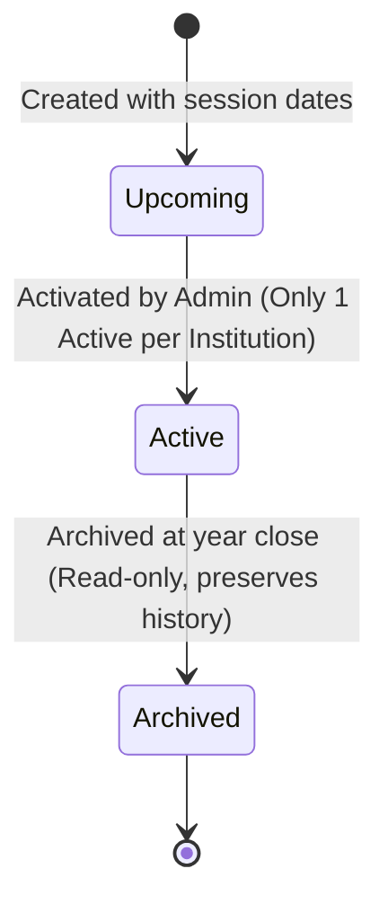
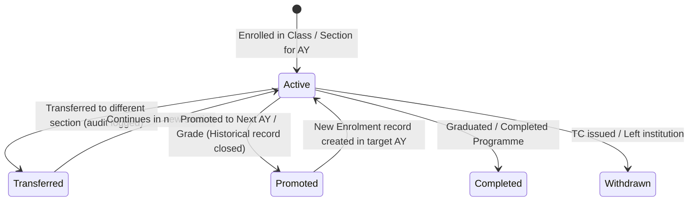

# ChhatraLekha Architecture: Academic Management Core

- **Document:** `ACADEMIC-MANAGEMENT-ARCHITECTURE.md`
- **Stage:** 0.8 (Academic Management Core)
- **Status:** Approved
- **Scope:** Multi-Tier Academic Hierarchy, Session Lifecycles, Curricula, Enrolment Progression, and Calendar

---

## 1. Architectural Principles

1. **Dual-Track Hierarchy**: Standalone schools and higher education institutions (colleges, universities, autonomous institutes) operate under different academic models. The architecture provides a unified data foundation without forcing school grades into university degree taxonomies or vice-versa.
2. **Immutable Historical Audit**: Academic progression (student promotion, section transfers, academic year transitions) creates new state records and marks superseded records as historical (`is_current: false`), preserving longitudinal transcripts and compliance audits.
3. **Multi-Tenant Isolation**: Every academic document belongs to an `institution_id`. Access is governed by role-based permissions and tenant scoping, preventing unauthorized cross-tenant reads or writes.
4. **NEP 2020 Alignment**: Subjects and programmes support credit-based modular frameworks, multilingual nomenclature, and dual theory/practical categorization.
5. **Timezone Standardization**: Academic calendar schedules, admission windows, and semester boundaries operate under Indian Standard Time (`Asia/Kolkata`).

---

## 2. Institutional Hierarchy Architecture

```mermaid
flowchart TD
    subgraph Universities & Colleges
        UNIV["University Level (Affiliating Body)"]
        INST["College / Constituent Institution"]
        CAMP["Physical / Virtual Campus"]
        DEPT["Academic Department (e.g. CSE, Mathematics)"]
        PROG["Academic Programme (e.g. B.Tech, M.Sc, Diploma)"]
        CRS["Course / Subject (Theory & Practical Credits)"]
        BATCH["Cohort Section / Batch"]
        
        UNIV --> INST
        INST --> CAMP
        CAMP --> DEPT
        DEPT --> PROG
        PROG --> CRS
        CRS --> BATCH
    end

    subgraph School System
        SCH["School Institution"]
        SCAMP["School Campus"]
        SAY["Academic Year (e.g. 2025-26)"]
        GRADE["Grade / Class (e.g. Class 10)"]
        SEC["Section (A, B, C)"]
        SSUB["Curriculum Subject"]
        
        SCH --> SCAMP
        SCAMP --> SAY
        SAY --> GRADE
        GRADE --> SEC
        SEC --> SSUB
    end
```

---

## 3. Academic Lifecycle State Transitions

### 3.1 Academic Year Lifecycle

- When a new academic year is set to `is_current: true`, all other academic years within the same institution have `is_current` set to `false`.
- When an academic year is archived (`is_archived: true`), existing enrolments, grades, and teacher assignments remain permanently intact for historical reporting.

### 3.2 Student Enrolment & Progression Lifecycle

- **Promote Action**:
  1. Finds existing active enrolment document `E_old`.
  2. Updates `E_old.status = 'promoted'` and `E_old.is_current = false`.
  3. Inserts new enrolment document `E_new` with target `academic_year_id`, `class_id`, `status = 'active'`, and `is_current = true`.
- **Duplicate Protection**:
  1. If an active enrolment already exists for `(institution_id, student_id, academic_year_id)`, any subsequent creation attempt is rejected with `HTTP 409 Conflict`.

---

## 4. Academic Calendar & Term Subsystem

- **Semester / Term Types**: `annual`, `semester`, `trimester`, `quarterly`.
- **Calendar Event Types**:
  - `holiday`: Mandatory institutional closures, public holidays, festival breaks.
  - `exam`: Formative and summative assessment schedules.
  - `admission`: Open application windows for new cohort intakes.
  - `event`: Sports meets, cultural fests, academic council meetings.
  - `term_start` & `term_end`: Boundary markers for teaching sessions.

---

## 5. Security & Boundary Isolation

- All endpoints under `/academic/*` require an authenticated session (`get_current_user`).
- Read-only endpoints (`GET`) permit access to enrolled students, parents, faculty, and administrative staff.
- Mutating endpoints (`POST`, `PUT`, `DELETE`) require administrative roles (`school_admin`, `college_admin`, `university_admin`, or `admin`).
- Database queries consistently scope queries to `{"institution_id": current_user["institution_id"]}` or the caller's authorized tenancy.
