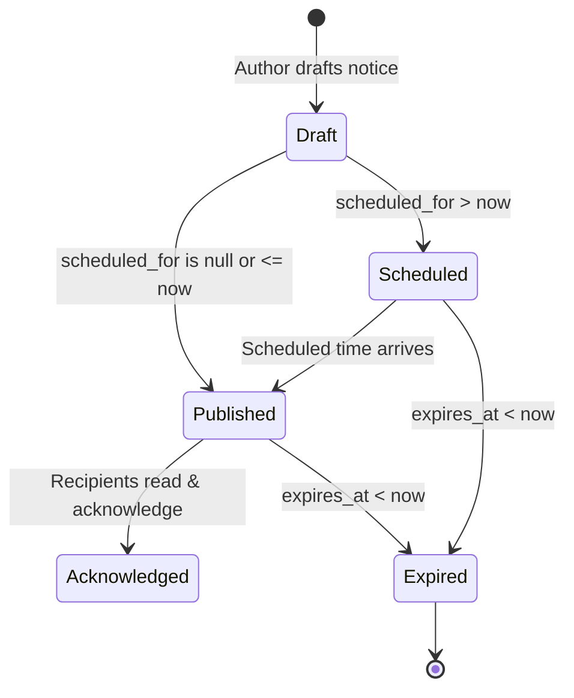

# ChhatraLekha Announcement Workflow Architecture
## Notice Publication, Audience Targeting, Scheduling & Delivery Analytics

- **Document Version:** 1.0.0
- **Status:** Approved Workflow
- **Date:** November 2026

---

## 1. Overview

The ChhatraLekha Announcement Workflow governs how institutional circulars, academic notices, and urgent communications are authored, approved, targeted, scheduled, dispatched, and acknowledged. It provides school, college, and university leaders with fine-grained control over communication reach while upholding strict multi-tenant data boundaries.

---

## 2. Announcement Lifecycle State Machine



### 2.1 State Definitions
1. **Draft**: Notice composition within the web or mobile interface, specifying title, content, priority, audience targets, attachments, and delivery channels.
2. **Scheduled**: The notice has a future publication timestamp (`scheduled_for > now`). It is saved in the database with status `SCHEDULED`. Staff members can view and edit it; student and parent interfaces hide it until the scheduled time.
3. **Published**: The notice is actively distributed across selected channels (`IN_APP`, `EMAIL`, `PUSH`) and visible to target audiences.
4. **Acknowledged**: Individual recipient digital read receipts are recorded in the `acknowledgements` array.
5. **Expired**: When `expires_at` is reached, the notice automatically expires and is excluded from active student listings unless the caller specifically requests expired notices.

---

## 3. Audience Scoping & Authority Verification

### 3.1 Audience Scopes
- **`ALL`**: The notice is broadcast to all active members of the institution (students, teachers, and guardians).
- **`DEPARTMENT`**: The notice is scoped to one or more academic departments specified in `target_departments` (e.g., `["Computer Science", "Information Technology"]`).
- **`CLASS`**: The notice is scoped to specific grade cohorts or classes specified in `target_classes` (e.g., `["Class 10-A", "Class 11-A"]`).
- **`ROLE`**: The notice is restricted to specific role designations via `target_role` (e.g., `"student"`, `"teacher"`, or `"parent"`).

### 3.2 Publisher Authority & Multi-Tenant Scoping
1. **Permission Check**: The author must possess the `MANAGE_ANNOUNCEMENTS` permission.
2. **Tenant Scoping**: The notice is assigned `institution_id = principal.institution_id`. Platform administrators can author cross-institution notices with `institution_id = "INST-ALL"`.
3. **Edit Guard**: When editing via `PUT /api/announcements/{id}`, the backend verifies that the caller's institution matches the document's institution:
   ```python
   if principal.role not in {"aicte_admin", "platform_operator"}:
       if doc.get("institution_id") != principal.institution_id:
           raise HTTPException(status_code=403, detail="Cross-institution edit prohibited.")
   ```

---

## 4. Document Attachments

Announcements support digital attachments such as circular PDFs, event posters, or syllabi:
- **`attachment_title`**: Human-readable label (e.g., `MidTerm_Schedule_2025.pdf`).
- **`attachment_url`**: Secure HTTPS URL pointing to institutional object storage or CDN.
- **Client Rendering**: Frontends display a dedicated download card with standard document icons and secure target link attributes.

---

## 5. Multi-Channel Dispatch & Delivery Analytics

When a notice is posted:
1. The announcement document is inserted into the `announcements` collection.
2. Delivery channels (`IN_APP`, `EMAIL`, `PUSH`) trigger asynchronous delivery simulation records stored in `notification_deliveries`.
3. Initial delivery metrics are computed and embedded in the document:
   ```json
   "delivery_summary": {
     "in_app": 150,
     "email": 142,
     "push": 118
   }
   ```
4. Administrators can fetch real-time analytics via `GET /api/announcements/{id}/delivery-summary`:
   - Total delivered across channels.
   - Total digital acknowledgements received.
   - Acknowledgement percentage rate:
     $$\text{Acknowledgement Rate} = \left(\frac{\text{Acknowledgement Count}}{\max(1, \text{Total In-App Delivery})}\right) \times 100\%$$

---

## 6. Digital Acknowledgement Workflow

For notices requiring proof of receipt (such as examination rules, disciplinary notices, or fee revisions):
1. The student or parent clicks **Acknowledge**.
2. Frontend dispatches `POST /api/announcements/{id}/acknowledge`.
3. Backend executes an atomic `$addToSet` update:
   ```python
   await db["announcements"].update_one(
       {"_id": announcement_id},
       {"$addToSet": {"acknowledgements": principal.subject}},
   )
   ```
4. The client receives confirmation and updates the notice badge to **Acknowledged** with a checkmark.
