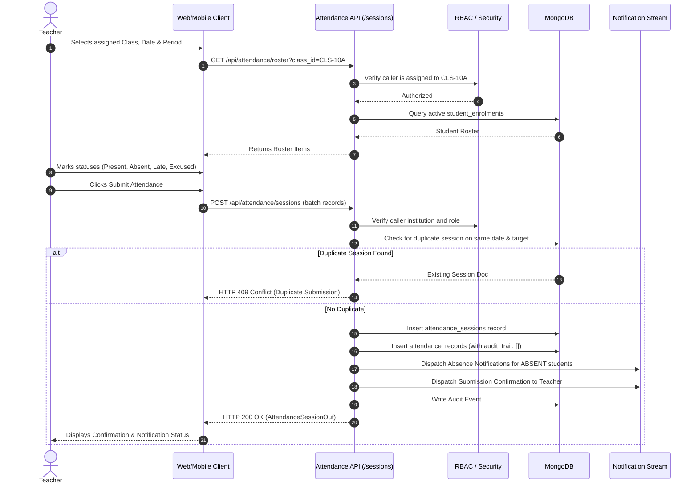
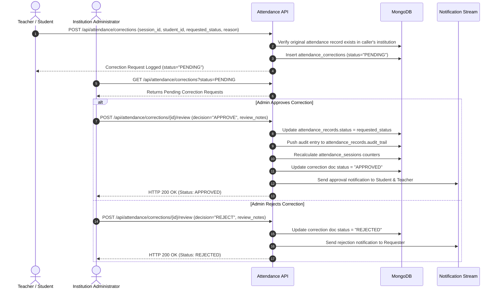

# ChhatraLekha Architecture: Attendance Workflows

- **Document:** `ATTENDANCE-WORKFLOW.md`
- **Stage:** 0.9 (Attendance Management System)
- **Status:** Approved
- **Scope:** Teacher Roll Call, Duplicate Protection, Absence Notification, and Auditable Corrections

---

## 1. Teacher Attendance Roll Call Workflow

---

## 2. Attendance Correction & Audit Workflow

---

## 3. Statutory Attendance Compliance Monitoring

1. **Threshold Rule**: Aligned with the National Education Policy (NEP 2020) and State Education Boards across India, students must maintain a minimum cumulative attendance of **75.0%** to qualify for semester examinations and internal assessments.
2. **Real-Time Evaluation**:
   $$\text{Attendance Rate} = \frac{\text{Present Sessions} + \text{Late Sessions}}{\text{Total Sessions}} \times 100$$
3. **Defaulter Escalation**:
   - Students whose cumulative rate falls below 75.0% receive proactive status warnings.
   - Administrators can review the "Statutory Defaulters" roster in the Attendance Overview tab.
   - Absence triggers consecutive alerts if a student is absent for 3 consecutive working days.

