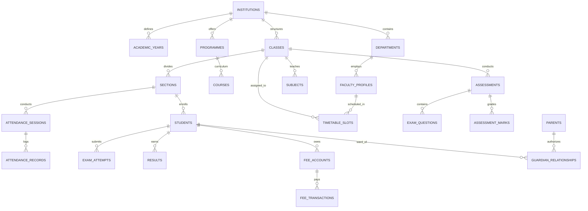
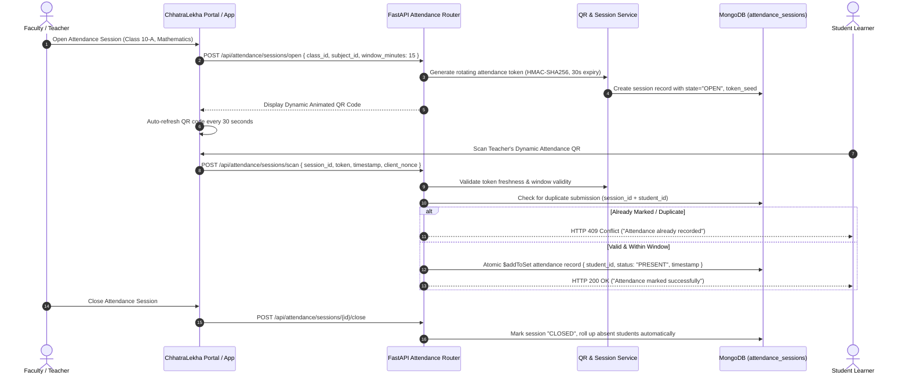
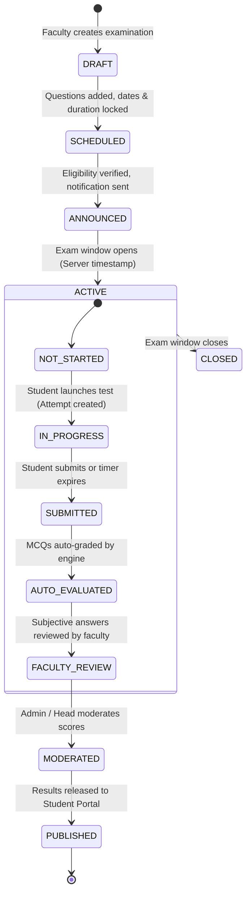
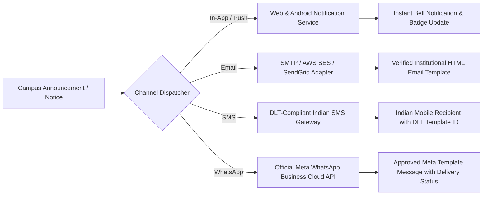
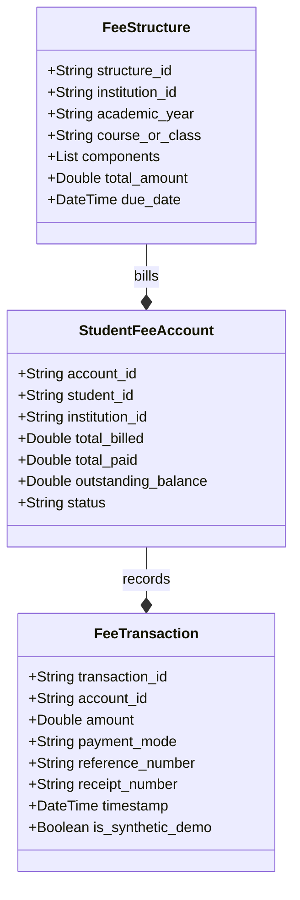

# ChhatraLekha — ERP Module Integration Architecture Map

**Document Reference:** `docs/architecture/ERP-MODULE-INTEGRATION-MAP.md`  
**Version:** 1.0.0  
**Authority:** Master Architectural Directive for ERP Evolution  
**Repository:** [ChhatraLekha](https://github.com/kumaribaishnabidas/ChhatraLekha.git)  
**Last Updated:** 2026-11-23  

---

## 1. System Topology & Architectural Invariants

ChhatraLekha evolves as a **Unified Modular Monolith** combining academic management, institutional operations, and digital credential verification into an integrated platform.

### Architectural Invariants:
1. **Single Persistent Database (MongoDB):** All modules persist to the existing MongoDB database (via the async `motor` driver). Zero migrations to relational engines (e.g. PostgreSQL) without an approved, verified architectural decision.
2. **Repository Boundary Enforcement:** Routers never execute unconstrained MongoDB queries. All persistence operations pass through dedicated repository classes in `chhatralekha/app/repositories/` with mandatory tenant scoping.
3. **Fail-Closed Multi-Tenancy:** Every mutation and query on multi-tenant collections requires an authenticated `institution_id`. Missing tenant context strictly fails closed with HTTP 400 Bad Request.
4. **Zero Cross-Institution Bleed:** Cross-tenant parameters are rejected with HTTP 403 Forbidden.

### 1.1 Architectural Component Map

```mermaid
graph TD
    subgraph Client Ecosystem
        Web["Web Portal & PWA (React 19 + Tailwind v4 + Vite 6)"]
        Android["Android Client (Kotlin + Jetpack Compose + Room SQLite)"]
        Linux["Linux Desktop Client (Electron Desktop Shell)"]
    end

    subgraph API Gateway & Hardening Layer
        Gateway["FastAPI ASGI Gateway (/api)"]
        SecHeaders["Security Headers Middleware (nosniff, DENY, HSTS)"]
        RateLimit["Rate Limiter (Token Bucket / IP)"]
        AuthMid["JWT Auth & Stateful Refresh Rotation (/refresh_sessions)"]
        DocGuard["API Documentation Gate (/docs, /redoc, /openapi.json 404 in Prod)"]
        TenantGuard["Tenant Isolation Context Guard (institution_id)"]
    end

    Web --> Gateway
    Android --> Gateway
    Linux --> Gateway

    Gateway --> SecHeaders --> RateLimit --> AuthMid --> DocGuard --> TenantGuard

    subgraph Master ERP Domain Services Layer
        S_Inst["Institution & Campus Administration"]
        S_Student["Student Lifecycle & Onboarding ERP"]
        S_Faculty["Faculty Workspace & Workload"]
        S_Attend["Smart Attendance & Dynamic QR"]
        S_Exam["Online Examination & Question Bank"]
        S_Sched["Timetable & Conflict Detection"]
        S_Records["Results, Grading & Transcripts"]
        S_Portal["Student & Parent Portal (DPDP Consent)"]
        S_Comm["Communication Hub (SMS, Email, WhatsApp)"]
        S_Fees["Fees & Financial Administration"]
        S_AI["Grounded Multilingual RAG Assistant"]
        S_Anomaly["10-Layer Regulatory Anomaly Engine"]
        S_Verify["Ed25519 Cryptographic Verification"]
    end

    TenantGuard --> S_Inst & S_Student & S_Faculty & S_Attend & S_Exam & S_Sched & S_Records & S_Portal & S_Comm & S_Fees & S_AI & S_Anomaly & S_Verify

    subgraph Data & Storage Tier (MongoDB & Edge Cache)
        M_Core[("Core Collections<br>institutions, programmes, classes, subjects, users")]
        M_Acad[("Academic Collections<br>students, attendance_sessions, assessments, results")]
        M_Ops[("Operations Collections<br>timetable_slots, questions, exam_attempts, fee_ledgers")]
        M_Audit[("Cryptographic Audit Chain<br>audit_events (SHA-256 hash-chained)")]
        EdgeRoom[("Android Room SQLite<br>(Offline Sync Cache)")]
    end

    S_Inst & S_Student & S_Faculty --> M_Core
    S_Attend & S_Records & S_Portal --> M_Acad
    S_Exam & S_Sched & S_Fees & S_Comm --> M_Ops
    S_Anomaly & S_Verify --> M_Audit
    Android <--> EdgeRoom
```

---

## 2. Institutional Entity Relationship Architecture



---

## 3. Router & Service Integration Mapping

| ERP Module | Primary API Router | Target Backend Service | Database Collections | Scope / Permissions |
| :--- | :--- | :--- | :--- | :--- |
| **Institution Administration** | `app/api/institutions.py`, `app/api/schools.py` | `app/repositories/institutions.py` | `institutions`, `schools`, `departments` | `platform_operator`, `aicte_admin`, `institution_admin` |
| **Student Management** | `app/api/students.py`, `app/api/me.py` | `app/repositories/students.py` | `students`, `claim_codes`, `enrollment_history` | `institution_admin`, `teacher` (assigned class), `student` (own record) |
| **Faculty Management** | `app/api/teacher.py` (extend to `faculty.py`) | `app/repositories/faculty.py` | `users` (`role="teacher"`), `faculty_profiles`, `assignments` | `institution_admin`, `teacher` (own profile) |
| **Smart Attendance** | `app/api/attendance.py` | `app/services/attendance.py` | `attendance_sessions`, `attendance_records` | `teacher` (assigned class), `institution_admin`, `parent` (ward), `student` (own) |
| **Online Examinations** | `app/api/assessments.py` (extend to `exams.py`) | `app/services/exam_engine.py` | `assessments`, `questions`, `exam_attempts` | `teacher` (authoring/grading), `student` (taking exam), `institution_admin` |
| **Timetable & Scheduling** | `app/api/academic.py` (`/timetable`) | `app/services/scheduler.py` | `timetable_slots`, `classrooms`, `holidays` | `institution_admin`, `teacher`, `student`, `parent` (read-only) |
| **Academic Records** | `app/api/assessments.py`, `app/api/me.py` | `app/services/grading.py` | `assessment_marks`, `results`, `transcripts` | `institution_admin`, `teacher` (moderator), `student`, `parent` |
| **Student & Parent Portal** | `app/api/parent.py`, `app/api/me.py` | `app/repositories/guardians.py` | `guardian_relationships`, `consents`, `notifications` | `parent` (verified ward), `student` (own records) |
| **Communication Hub** | `app/api/announcements.py`, `app/api/comm.py` | `app/services/communication.py` | `announcements`, `notifications`, `message_dispatches` | `institution_admin`, `teacher` (assigned class only) |
| **Fees & Financials** | `app/api/fees.py` (New Module) | `app/services/fee_engine.py` | `fee_structures`, `fee_accounts`, `fee_receipts` | `institution_admin`, `student` (own dues), `parent` (ward dues) |
| **AI Assistant & RAG** | `app/api/ai.py` | `app/services/ai_assistant.py` | Platform vector embeddings, approved docs | Authenticated users (scoped to caller permissions) |
| **Regulatory Anomaly Engine** | `app/api/anomalies.py` | `app/services/anomaly_engine.py` | `anomalies`, `review_cases`, `intake_rules` | `aicte_admin`, `institution_admin` |
| **Credential Verification** | `app/api/verify.py`, `app/api/tokens.py` | `app/services/seal.py`, `key_registry.py` | `tokens`, `revoked_credentials`, `audit_events` | Public (`/verify`), Authenticated (`/tokens`) |

---

## 4. Multi-Tenant Role & Scope Hierarchy

```
[National / Regulatory Directorate] (aicte_admin, platform_operator)
       │
       ▼
[University Administration] (university_admin)
       │
       ▼
[Institution Administration] (institution_admin, school_admin, college_admin)
       │
       ├─────────────────────────────────────┐
       ▼                                     ▼
[Academic Department / Branch]       [School Grade / Division]
       │                                     │
       ▼                                     ▼
[Faculty / Teachers] (teacher)        [Class Teachers] (teacher)
       │                                     │
       ├─────────────────────────────────────┤
       ▼                                     ▼
[Enrolled Student] (student)         [Authorized Guardian] (parent)
```

### RBAC Enforcement Rules:
1. `student` can only access records where `student_id == principal.subject` or `apaar_id == principal.apaar_id`.
2. `parent` can only access records for wards verified in `guardian_relationships` linked to `parent_user_id == principal.subject`.
3. `teacher` can only access student lists, attendance sheets, and draft marks for classes/subjects explicitly linked in `teacher_assignments`.
4. `institution_admin` can manage all data within their assigned `institution_id`.
5. `aicte_admin` / `platform_operator` have multi-tenant audit access across all institutions for regulatory oversight.

---

## 5. Dynamic Smart Attendance & QR Verification Workflow



---

## 6. Online Examination (CBT) State Machine



---

## 7. Multi-Channel Communication Architecture



---

## 8. Financial & Fee Ledger Architecture (Synthetic Prototype Mode)

### Architectural Guardrails:
- In prototype mode, payment integration must use synthetic demo gateways with zero live credit card or UPI processing.
- All financial balances are modeled using double-entry ledger semantics (`debit_amount`, `credit_amount`, `balance`).


