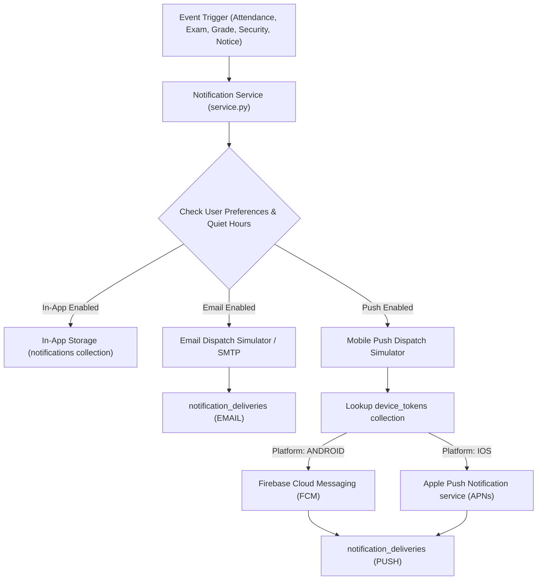

# ChhatraLekha Notification Delivery Architecture
## Multi-Channel Dispatch, Push Integration & Device Lifecycle

- **Document Version:** 1.0.0
- **Status:** Approved Architecture
- **Date:** November 2026

---

## 1. Architecture Overview

ChhatraLekha's notification system connects the central academic engine with students, parents, faculty, and institutional administrators across four primary delivery channels:
1. **In-App Notifications**: Real-time persistent notification center, bell counter, and drawer modal.
2. **Email Notifications**: Formatted HTML/text templates dispatched to verified email addresses.
3. **Android Push Notifications**: Low-latency mobile pushes delivered via Firebase Cloud Messaging (FCM).
4. **iOS Push Notifications**: Native Apple Push Notification service (APNs) alerts and badges.



---

## 2. Channel Architecture Specifications

### 2.1 In-App Notification Channel
- **Storage**: Persisted to the `notifications` collection in MongoDB.
- **Identification**: Each notice is assigned a unique `notification_id` (`NTF-<hex>`).
- **Targeting**: Either user-scoped (`user_id = principal.subject`) or institution-scoped (`user_id = null`, `institution_id = principal.institution_id`).
- **Read State**: Tracked per document (`is_read: bool`, `read_at: datetime`).
- **Pagination**: Backed by `GET /api/notifications` (with pagination response headers) and `GET /api/notifications/paged` (with total count, pages, and unread counts).

### 2.2 Email Notification Channel
- **Trigger Scenarios**: Daily attendance digests, urgent warnings, published semester grade cards, and institutional circulars.
- **Recipient Resolution**: Queries user profile for verified contact email addresses.
- **Template System**: Standard header, institution affiliation banner, priority indicators, and deep link call-to-action buttons.
- **Quiet Hours Resiliency**: Non-urgent emails are queued during user-configured quiet hours and released in a morning digest batch. Critical security alerts bypass quiet hours immediately.
- **Delivery Log**: Each dispatch registers an audit log entry in `notification_deliveries`.

### 2.3 Android Push Notification Channel (FCM)
- **Client Integration**: Android Kotlin native application (`android/app/`).
- **Token Registration**: The mobile client obtains a registration token via Firebase Messaging SDK and registers it with the backend via `POST /api/notifications/devices`.
- **Payload Schema**:
  ```json
  {
    "to": "fcm_device_token",
    "notification": {
      "title": "Semester Grade Card Published",
      "body": "Your validated term report card for Semester 4 is now available.",
      "sound": "default"
    },
    "data": {
      "notification_id": "ntf-06",
      "category": "RESULTS",
      "priority": "HIGH",
      "deep_link": "/me/results"
    }
  }
  ```
- **Tap Handling**: Deep link resolution maps to native activities or web view routes.
- **Token Revocation**: When the user signs out or disables push notifications, `DELETE /api/notifications/devices/{token}` removes the token from the active device pool.

### 2.4 iOS Push Notification Channel (APNs)
- **Client Integration**: Native SwiftUI application (`ios/ChhatraLekha/`).
- **Token Registration**: `didRegisterForRemoteNotificationsWithDeviceToken` extracts the 64-character hex device token and posts it to `POST /api/notifications/devices` with `platform: "IOS"`.
- **APNs Payload Schema**:
  ```json
  {
    "aps": {
      "alert": {
        "title": "Mid-Term Examination Schedule Released",
        "body": "The mid-term examination timetable for Semester 5 has been officially published."
      },
      "badge": 1,
      "sound": "default",
      "category": "EXAMINATIONS"
    },
    "notification_id": "ntf-03",
    "deep_link": "/me/results"
  }
  ```
- **Infrastructure Status & Requirements**:
  - Real APNs dispatch requires Apple Developer Program membership, an APNs Authentication Key (`.p8`), Team ID, Key ID, and Push Notifications entitlement enabled in Xcode.
  - In local development and non-production CI environments, push dispatch runs in simulation mode, recording delivery payloads in `notification_deliveries` without blocking application lifecycles.

---

## 3. Database Collections & Schemas

### 3.1 `device_tokens` Collection
Stores registered mobile client tokens for push delivery:
```json
{
  "_id": "ObjectId(...)",
  "device_id": "DEV-3a9f8c",
  "user_id": "user-uuid",
  "token": "device-push-token-string",
  "platform": "ANDROID", // or "IOS"
  "device_name": "Pixel 8 Pro",
  "device_model": "Google Pixel",
  "app_version": "2.0.0",
  "registered_at": "2026-11-06T10:00:00Z",
  "last_active_at": "2026-11-06T10:00:00Z",
  "ip_address": "127.0.0.1"
}
```

### 3.2 `notification_preferences` Collection
Stores user-level channel subscriptions, quiet hours, and language preferences:
```json
{
  "_id": "ObjectId(...)",
  "user_id": "user-uuid",
  "in_app_enabled": true,
  "email_enabled": true,
  "push_enabled": true,
  "quiet_hours_enabled": true,
  "quiet_hours_start": "22:00",
  "quiet_hours_end": "07:00",
  "language_preference": "hi",
  "subscribed_categories": [
    "ACADEMIC",
    "ATTENDANCE",
    "ASSIGNMENTS",
    "EXAMINATIONS",
    "RESULTS",
    "TIMETABLE",
    "ANNOUNCEMENTS",
    "ADMISSIONS",
    "ADMINISTRATIVE",
    "SECURITY"
  ],
  "updated_at": "2026-11-06T10:00:00Z"
}
```

### 3.3 `notification_deliveries` Collection
Records asynchronous dispatch history across email and push simulation workers:
```json
{
  "_id": "ObjectId(...)",
  "delivery_id": "DEL-9e41b",
  "notification_id": "NTF-89c2fa",
  "channel": "EMAIL", // "IN_APP", "EMAIL", "PUSH"
  "recipient": "student@institution.edu.in",
  "status": "SENT", // "SENT", "SIMULATED", "FAILED"
  "attempt_count": 1,
  "sent_at": "2026-11-06T10:00:01Z",
  "error_message": null
}
```

---

## 4. Security & Privacy Guarantees

1. **User Ownership**: All mutation and deletion endpoints (`POST /read`, `POST /read-all`, `DELETE /{id}`) strictly require `user_id == principal.subject`, preventing IDOR vulnerabilities.
2. **Tenant Scoping**: Institutional broadcast notices are strictly filtered to the caller's institution ID or the global broadcast scope `INST-ALL`.
3. **Mandatory Security Delivery**: Critical account and authentication events cannot be suppressed by changing user preferences.
4. **Token Isolation**: Device tokens are tied directly to authenticated user IDs and can only be revoked by the token owner or administrative account purge routines.
