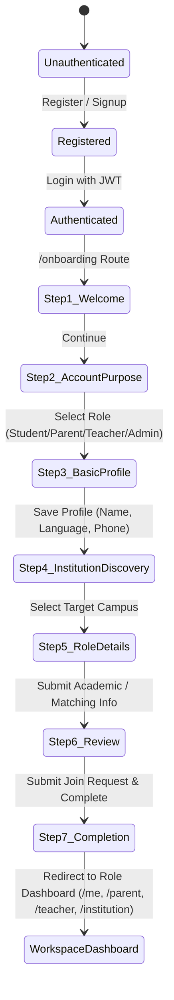
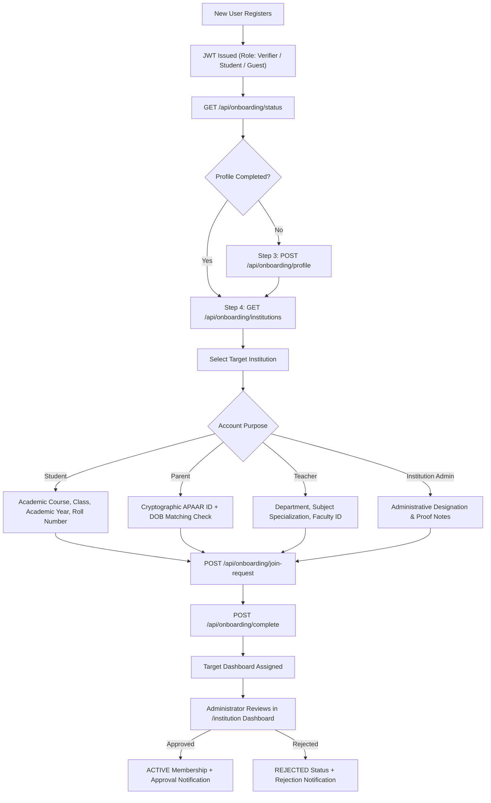

# Architecture Specification
## Onboarding Workflow and Institutional Access Lifecycle

**Platform:** ChhatraLekha  
**Subsystem:** User Onboarding & Institution Membership  
**Status:** Implemented and Verified  

---

### 1. Architectural Overview

The ChhatraLekha onboarding architecture establishes a unified identity lifecycle across students, parents, faculty, and educational institutions. Rather than siloing account creation into separate applications, the platform employs a centralized 7-step onboarding state machine that separates universal personal identity from institution-specific and role-specific memberships.



---

### 2. State Machine Transitions



---

### 3. Data Models and Schemas

#### A. Membership Request (`membership_requests` collection)
```json
{
  "_id": "MREQ-8F12A0",
  "request_id": "MREQ-8F12A0",
  "user_id": "USR-102938",
  "user_name": "Aarav Sharma",
  "user_email": "aarav@example.com",
  "institution_id": "INST-0421",
  "institution_name": "Delhi Institute of Technology",
  "requested_role": "student",
  "role_details": {
    "course_name": "B.Tech Computer Science",
    "class_grade": "3rd Year",
    "academic_year": "2024-25",
    "student_identifier": "ROLL-2024-001"
  },
  "status": "PENDING",
  "created_at": "2026-11-06T12:00:00Z",
  "reviewed_by": null,
  "reviewed_at": null,
  "review_notes": null
}
```

#### B. Institutional Membership (`institution_memberships` collection)
```json
{
  "_id": "MEM-3B91C2",
  "membership_id": "MEM-3B91C2",
  "user_id": "USR-102938",
  "institution_id": "INST-0421",
  "institution_name": "Delhi Institute of Technology",
  "role": "student",
  "role_label": "Student",
  "department": "B.Tech Computer Science",
  "academic_year": "2024-25",
  "is_primary": true,
  "member_status": "ACTIVE",
  "created_at": "2026-11-06T12:30:00Z"
}
```

#### C. Guardian Relationship (`guardian_relationships` collection)
```json
{
  "_id": "GLINK-55A1F9",
  "link_id": "GLINK-55A1F9",
  "parent_user_id": "USR-PARENT-01",
  "parent_email": "sunita@example.com",
  "student_id": "STU-APAAR-9999",
  "student_name": "Aarav Sharma",
  "institution_id": "INST-0421",
  "relationship": "Mother",
  "status": "PENDING",
  "requested_at": "2026-11-06T12:00:00Z"
}
```

---

### 4. Role-to-Dashboard Routing Contract

Upon completing the onboarding flow (`POST /api/onboarding/complete`), the backend returns the canonical target workspace route corresponding to the user persona:

| Selected Role | Target Dashboard Route | Authorized Capabilities |
| :--- | :--- | :--- |
| `student` | `/me` | View APAAR ID card, attendance, verifiable results, and student wallet. |
| `parent` | `/parent` | View linked child attendance, exam progress, and institutional alerts. |
| `teacher` | `/teacher` | Record period roll-call, review assignments, and post classroom bulletins. |
| `institution_admin` | `/institution` | Manage campus intake, student register, and review join requests. |
| `college_admin` | `/institution` | Manage collegiate programmes, compliance records, and faculty roles. |
| `school_admin` | `/institution` | Manage school rosters, attendance, and administrative certifications. |
| `university_admin` | `/dashboard` | Provisioned via administrator invitation only; access aggregate metrics. |
| `national_admin` | `/dashboard` | Provisioned via platform operator only; national registry oversight. |

