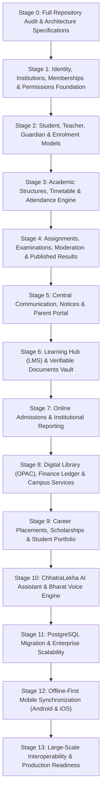

# ChhatraLekha — Master Phased Implementation Roadmap

**Document Version:** 1.0.0  
**Status:** Approved Target Architecture (Stage 0 Deliverable)

---

## 1. Master Staging Overview

The evolution of ChhatraLekha into a unified Education Super Platform proceeds across **14 distinct stages**. Each stage has defined entry criteria, deliverables, automated test verification, and rollback safeguards.

---

## 2. Detailed Stage Breakdown

### Stage 0: Repository Audit & Architecture Specifications (Current Deliverable)
- **Status:** **COMPLETED**
- **Deliverables:** Complete set of 11 architectural, database, workflow, and security specifications in `docs/`.
- **Verification:** All existing 24 backend test suites and 68 frontend tests passing without regression.

### Stage 1: Identity, Institutions, Memberships & Permissions Foundation
- **Objective:** Establish the multi-institution membership model (`User -> InstitutionMembership -> Role -> Permissions`).
- **Deliverables:**
  - `InstitutionMembership` model and repository in `app/repositories/memberships.py`.
  - Multi-membership JWT token handling in `app/api/auth.py`.
  - FastAPI `TenantContext` dependency with `X-Institution-ID` resolution.
  - Multi-tenant institution switcher in `frontend/src/components/layout/AppLayout.jsx`.
  - Automated cross-tenant isolation test suite (`test_membership_and_tenancy.py`).

### Stage 2: Student, Teacher, Guardian & Enrolment Models
- **Objective:** Model people independently of user accounts.
- **Deliverables:**
  - `StudentProfile`, `StaffProfile`, `GuardianRelationship` collections.
  - Student claim code generation & self-activation flow.
  - Verified parent-ward relationship approval workflow.

### Stage 3: Academic Structures, Timetable & Attendance Engine
- **Objective:** Unify school streams (K-12) and university degree programmes with attendance.
- **Deliverables:**
  - Academic hierarchy (Year -> Term -> Dept -> Programme -> Course -> Class -> Section -> Subject).
  - Teacher subject assignment engine.
  - Timetable period schedule viewer.
  - Session-by-session classroom attendance marking with change-impact audit tracking.

### Stage 4: Assignments, Examinations, Moderation & Results
- **Objective:** Academic grading, moderation, and verifiable result publication.
- **Deliverables:**
  - Assessment scheduler, marks entry interface.
  - Departmental moderation approval queue.
  - Cryptographically sealed transcript generation into student wallet.

### Stage 5: Central Communication & Parent Portal
- **Objective:** Unified notifications and family oversight.
- **Deliverables:**
  - Targeted announcement broadcast (campus, department, class, guardians).
  - Dedicated Parent Portal dashboard displaying ward attendance and exam performance.

### Stage 6: Learning Hub (LMS) & Verifiable Documents
- **Objective:** Educational material distribution and student submissions.
- **Deliverables:**
  - Subject study material repository (PDF notes, recorded lecture links).
  - Assignment submission portal with file attachment uploads.
  - Verifiable bonafide certificate and transfer certificate issuance.

### Stage 7: Admissions & Institutional Reporting
- **Objective:** Configurable application and compliance workflows.
- **Deliverables:**
  - Online admission application form with document upload checklist.
  - Merit list generation based on criteria.
  - Institutional accreditation reports exportable for regulatory authorities.

### Stage 8: Digital Library (OPAC), Finance & Campus Facilities
- **Objective:** Ancillary campus operations.
- **Deliverables:**
  - OPAC book catalog, stock availability, due date reminders.
  - Classroom/lab/equipment booking schedule.
  - Fee structure definition and payment receipt ledger.

### Stage 9: Opportunities, Placements, Scholarships & Portfolio
- **Objective:** Student career development and discovery.
- **Deliverables:**
  - Central opportunity hub for verified scholarships and internships.
  - Student digital skill profile and verifiable resume export.
  - Alumni network directory and mentorship pairing.

### Stage 10: Grounded AI Assistant & Bharat Voice Engine
- **Objective:** Intelligent, inclusive multilingual campus.
- **Deliverables:**
  - Role-aware RAG query engine grounded in active tenant records.
  - Speech-to-text voice input and audio text-to-speech across all 22 Eighth Schedule languages.
  - Accessibility keyboard navigation and screen-reader compliance.

### Stage 11: PostgreSQL Relational Migration & Scale
- **Objective:** Relational integrity for enterprise scale.
- **Deliverables:**
  - Alembic migration scripts mapping MongoDB collections to PostgreSQL tables.
  - Row-Level Security (`RLS`) policy enforcement on `institution_id`.
  - Zero-downtime data replication and rollback verification.

### Stage 12: Offline-First Mobile Super App (Android & iOS)
- **Objective:** Mobile client parity and low-bandwidth resilience.
- **Deliverables:**
  - Android Jetpack Compose Room cache with WorkManager sync.
  - iOS SwiftData cache with background session sync.
  - Cryptographic conflict detection and server-authoritative reconciliation.

### Stage 13: Large-Scale Interoperability & Audit Review
- **Objective:** Production hardening and national pilot readiness.
- **Deliverables:**
  - Load testing with 100,000+ synthetic student records across 50+ institutions.
  - Penetration testing, DPDP Act compliance audit, and automated disaster recovery drill.

---

## 3. Risk Register & Rollback Strategy

| Risk Identified | Severity | Mitigation & Rollback Plan |
| :--- | :--- | :--- |
| **Breaking Existing Demo Accounts** | High | All demo accounts (`student.demo@example.com`, etc.) will receive pre-seeded default memberships, ensuring existing 1-click logins remain 100% operational. |
| **Performance Overhead of Tenant Checks** | Medium | Tenant context is cached in request state (`request.state.tenant`); membership queries are indexed by compound key `(user_id, institution_id)`. |
| **Silent Offline Overwrites** | High | The server enforces optimistic concurrency checks (`version` number); outdated client updates are rejected and flagged for manual resolution. |
| **Database Migration Data Loss** | Critical | Stage 11 maintains dual-write shadow logging before traffic switchover; rollback scripts restore MongoDB snapshot in under 60 seconds. |
