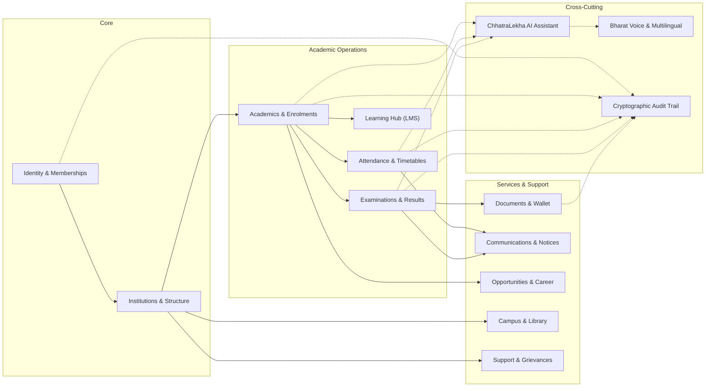

# ChhatraLekha — Module Boundaries & Domain Architecture

**Document Version:** 1.0.0  
**Status:** Approved Target Architecture (Stage 0 Deliverable)

---

## 1. Domain Boundary Rules

To ensure modularity and prevent spaghetti dependencies, all business logic is organized into bounded contexts. 

1. **No Direct Inter-Module Database Access:**
   Module A must never directly query or mutate collections/tables owned by Module B. Cross-module data retrieval must occur via documented service methods or domain events.
2. **Repository Decoupling:**
   Each module defines its repository interface independently of persistence mechanics (Motor MongoDB or PostgreSQL).
3. **Domain Event Broadcasting:**
   Lifecycle changes (e.g., `ENROLMENT_CREATED`, `ATTENDANCE_RECORDED`, `RESULT_PUBLISHED`) emit structured domain events consumed by notifications, audit logging, and reporting.

---

## 2. Bounded Contexts & Module Registry

---

## 3. Module Specifications & Responsibilities

### Module 1: Identity & Membership (`app/modules/identity/`)
- **Owns:** `User`, `InstitutionMembership`, `Session`, `APIKey`.
- **Responsibilities:** Central account creation, authentication, password recovery, membership role attachment, session token generation (`JWT`).
- **Public Interface:** `get_user(user_id)`, `resolve_membership(user_id, institution_id)`, `verify_permission(membership, permission)`.

### Module 2: Institutions & Academics (`app/modules/academics/`)
- **Owns:** `Institution`, `AcademicYear`, `Department`, `Programme`, `Course`, `ClassGroup`, `Section`, `Subject`.
- **Responsibilities:** Academic structure hierarchy, sanctioned seat capacity, stream definitions (Science, Commerce, Arts, Vocational), course prerequisite management.
- **Public Interface:** `get_active_academic_year(institution_id)`, `get_class_roster(class_id)`.

### Module 3: People & Enrolments (`app/modules/enrolments/`)
- **Owns:** `StudentProfile`, `StaffProfile`, `StudentEnrolment`, `GuardianRelationship`, `TeacherAssignment`.
- **Responsibilities:** Time-bounded student class placements, staff appointments, teacher subject assignments, verified guardian connections.
- **Public Interface:** `is_guardian_verified(guardian_id, student_id)`, `get_teacher_assignments(teacher_id)`.

### Module 4: Attendance & Timetable (`app/modules/attendance/`)
- **Owns:** `AttendanceSession`, `AttendanceRecord`, `TimetableSlot`.
- **Responsibilities:** Period scheduling, real-time classroom attendance taking, cumulative attendance calculation, holiday overrides, attendance notification triggers.
- **Public Interface:** `get_student_attendance_summary(student_id, term_id)`, `get_timetable_for_day(entity_type, entity_id, day)`.

### Module 5: Examinations & Results (`app/modules/examinations/`)
- **Owns:** `Assessment`, `AssessmentMarks`, `ResultPublication`, `TranscriptRecord`.
- **Responsibilities:** Continuous assessments, semester exams, marks entry, moderation approval workflow, GPA/CGPA computation, transcript publication.
- **Public Interface:** `get_published_results(student_id)`, `submit_marks_for_moderation(assessment_id)`.

### Module 6: Learning Hub & LMS (`app/modules/learning/`)
- **Owns:** `LearningMaterial`, `Assignment`, `Submission`, `QuizSession`.
- **Responsibilities:** Syllabus materials, PDF/notes repository, assignment distribution, student document submissions, teacher grading and feedback.

### Module 7: Opportunities & Career (`app/modules/opportunities/`)
- **Owns:** `Opportunity`, `Scholarship`, `Internship`, `StudentPortfolio`.
- **Responsibilities:** Scholarship catalog, placement drives, demographic eligibility verification, student resume and project showcase.

### Module 8: Campus, Library & Helpdesk (`app/modules/campus/`)
- **Owns:** `LibraryBook`, `BookLoan`, `Facility`, `FacilityBooking`, `SupportTicket`.
- **Responsibilities:** OPAC book inventory, borrowing limits, due dates, classroom/lab reservation, confidential student grievance ticketing with policy escalation.

### Module 9: ChhatraLekha AI & Voice (`app/modules/ai/`)
- **Owns:** `KnowledgeChunk`, `ConversationThread`, `VoiceIntent`.
- **Responsibilities:** Permission-filtered document retrieval (RAG), intent classification in 22 languages, speech-to-text transcript normalization, text-to-speech synthesis.
