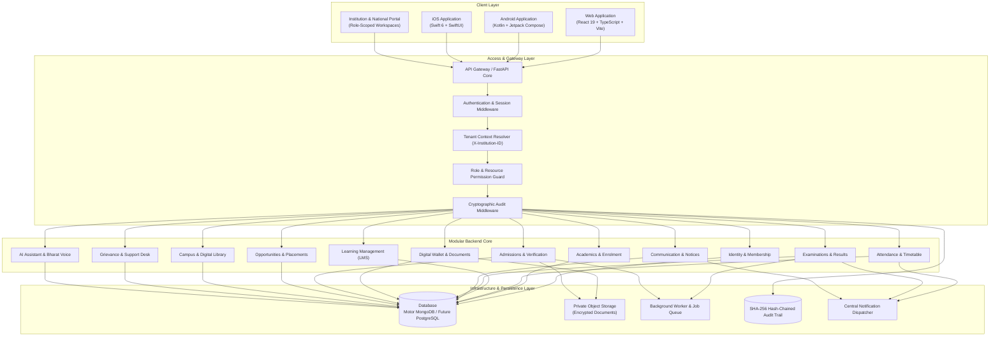
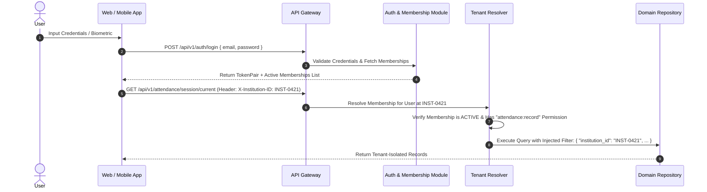

# ChhatraLekha — System Architecture Specification

**Document Version:** 1.0.0  
**Status:** Approved Target Architecture (Stage 0 Deliverable)  
**Target:** Unified National Education Super Platform for India

---

## 1. Existing Architecture (Verified Repository Audit)

The source of truth for the existing system is the actual codebase in the Git repository:

```
ChhatraLekha/
├── frontend/                     # React 19 + Vite 6 + Tailwind CSS v4 SPA
│   ├── src/components/           # Layouts (AppLayout, PublicLayout, DemoGuide), common UI, AI drawer
│   ├── src/pages/                # 29 pages (Dashboard, Student, Teacher, Parent, Verification)
│   ├── src/services/api.js       # Axios client with interceptors, tokenStore, base URL configuration
│   ├── src/i18n/                 # 22 Eighth Schedule Indian languages catalogue & JSON bundles
│   └── src/test/                 # 68 Vitest test cases (DesignLint, API, Format, Auth, Pages)
├── chhatralekha/                 # FastAPI (Python 3.12+) asynchronous ASGI backend
│   ├── app/main.py               # Lifespan events, CORS, security headers, router mounts
│   ├── app/api/                  # 21 REST routers (auth, ai, students, academic, attendance, etc.)
│   ├── app/core/                 # config (Pydantic), security (JWT/bcrypt/HMAC), database (Motor)
│   ├── app/models/               # documents.py (Doc wrapper), enums.py (Domain enumerations)
│   ├── app/repositories/         # Data access classes (users, students, tokens, audit, institutions)
│   ├── app/services/             # Domain logic (apaar_validator, anomaly_engine, ai_assistant)
│   └── tests/                    # 24 pytest suites using in-memory MongoDB
├── android/                      # Native Android Kotlin application
│   └── app/src/main/             # Jetpack Compose UI, Room DB (AppDatabase), WorkManager sync
├── ios/                          # Native iOS application
│   └── ChhatraLekha/             # Swift 6, SwiftUI, SwiftData, Keychain token storage
├── docs/                         # Specifications, ADRs, user guides, landing page HTML
├── docker-compose.yml            # Multi-service container orchestration
└── README.md                     # Project documentation & statutory disclaimers
```

### Verified Existing Functionality:
1. **Multi-Role Authentication & Demo Access:** JWT access tokens (`15m`), refresh tokens (`7d`), bcrypt hashing, rate limiting, and 1-click ephemeral demo logins for 6 personas (`student.demo`, `parent.demo`, `teacher.demo`, `schooladmin.demo`, `collegeadmin.demo`, `universityadmin.demo`).
2. **Student Digital ID & Wallet:** Masked APAAR ID (`****-****-1234`), printable digital badge, opaque revocable QR verification tokens, and PDF certificates.
3. **Campus Operations:** Teacher session attendance marking, daily period timetables, internal assessment entry.
4. **Regulatory Anomaly Detection:** Real-time compliance engine enforcing AICTE Approval Process Handbook (APH) intake ceilings, supernumerary quotas, and cross-college duplicate enrollment detection.
5. **Cryptographic Audit Trail:** Immutable SHA-256 hash-chained log (`audit_events`) recording credential issuance, verification scans, and record revisions.
6. **Multilingual AI Assistant:** Permission-aware RAG query engine grounded in official documentation and regulatory rules with text/voice input and audio TTS playback in 22 languages.
7. **5,000 Fictional Synthetic Student Records:** Procedurally generated load-test database across Indian states with `is_demo: true`.

---

## 2. Proposed Target Architecture (Modular Monolith)

The platform is evolving into a unified **Education Super Platform** serving schools, colleges, universities, students, parents, and teachers without fragmenting into disconnected apps.



---

## 3. Frontend, Backend & Mobile Communication Contract

All clients (Web, Android, iOS) interact with the same versioned RESTful backend (`/api/v1/`):

1. **Protocol:** HTTPS with strict TLS 1.3 encryption.
2. **Standard Request Headers:**
   - `Authorization: Bearer <jwt_access_token>`
   - `X-Institution-ID: <target_institution_id>` (Specifies active institutional membership context)
   - `X-Request-ID: <uuid>` (Unique per client request for distributed tracing)
   - `Accept-Language: <iso_code>` (`en`, `hi`, `or`, `ta`, etc.)
3. **Response Envelope Conventions:**
   - Standard 2xx payloads return data directly or wrapped in domain objects: `{ "data": ... }`.
   - Error responses adhere to RFC 7807: `{ "detail": "Human readable message", "code": "ERROR_CODE", "field": "optional_field" }`.
4. **Mobile Synchronization Contract:**
   - Mobile clients send batch synchronization payloads containing an array of timestamped operations with client-generated UUIDs (`sync_id`).
   - Server validates tenant permissions, checks optimistic concurrency locks, applies valid operations, and returns a reconciliation state.

---

## 4. Authentication and Authorization Flow



---

## 5. Deployment and Infrastructure

1. **Containerized Architecture:**
   - Backend packaged as non-root container with Uvicorn worker threads.
   - Frontend built into static bundle hosted on high-performance CDN / edge caches.
   - Docker Compose orchestrates local development environments with MongoDB and test mocks.
2. **Storage Architecture:**
   - Sensitive student documents (marksheets, transfer certificates) are stored in private object storage (S3/GCS compliant) with presigned, time-limited download URLs.
3. **Monitoring & Auditing:**
   - Structured JSON logging with request tracing (`X-Request-ID`).
   - Hash-chained audit records (`audit_events`) backed up to write-once append-only storage.
