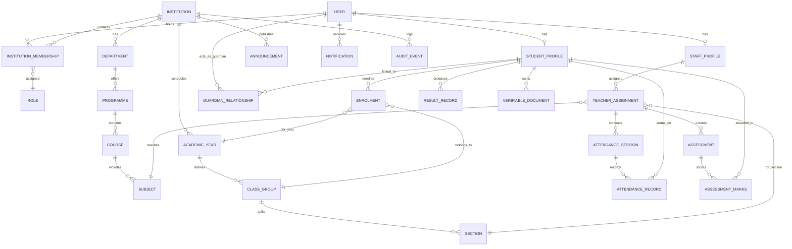

# ChhatraLekha — Entity-Relationship Model & Database Specification

**Document Version:** 1.0.0  
**Status:** Approved Target Architecture (Stage 0 Deliverable)

---

## 1. Conceptual Entity-Relationship Diagram

---

## 2. Core Entity Definitions & Schemas

### 2.1 Identity & Membership Domain

#### `USER`
- `user_id`: Primary Key (String `USR-XXXX-XXXX`)
- `email`: Indexed unique string (lower-cased)
- `phone`: Nullable string (+91 format)
- `password_hash`: String (bcrypt hashed)
- `full_name`: String
- `preferred_language`: String (ISO-639-1 code e.g. `en`, `hi`, `or`, `ta`)
- `is_active`: Boolean
- `created_at`: UTC Datetime
- `updated_at`: UTC Datetime

#### `INSTITUTION_MEMBERSHIP`
- `membership_id`: Primary Key (String `MEM-XXXX-XXXX`)
- `user_id`: Foreign Key (`USER.user_id`)
- `institution_id`: Foreign Key (`INSTITUTION.institution_id`)
- `role`: Enum (`STUDENT`, `PARENT`, `TEACHER`, `SCHOOL_ADMIN`, `COLLEGE_ADMIN`, `UNIV_ADMIN`, `VERIFIER`)
- `permissions`: Array of strings
- `status`: Enum (`INVITED`, `ACTIVE`, `SUSPENDED`, `ALUMNI`, `WITHDRAWN`)
- `start_date`: Date
- `end_date`: Nullable Date
- `metadata`: JSON object (Roll number, Staff ID, Department ID, Quota)

#### `GUARDIAN_RELATIONSHIP`
- `relationship_id`: Primary Key (`REL-XXXX-XXXX`)
- `guardian_user_id`: Foreign Key (`USER.user_id`)
- `student_id`: Foreign Key (`STUDENT_PROFILE.student_id`)
- `relationship_type`: Enum (`FATHER`, `MOTHER`, `LEGAL_GUARDIAN`, `OTHER`)
- `verification_status`: Enum (`PENDING_VERIFICATION`, `VERIFIED`, `REJECTED`, `REVOKED`)
- `verified_by_staff_id`: Nullable Foreign Key (`STAFF_PROFILE.staff_id`)
- `verified_at`: Nullable UTC Datetime

---

### 2.2 Academic Structure & Enrolment Domain

#### `INSTITUTION`
- `institution_id`: Primary Key (`INST-XXXX` or `SCH-XXXX`)
- `institution_name`: String
- `category`: Enum (`SCHOOL`, `COLLEGE`, `UNIVERSITY`, `DIRECTORATE`)
- `kind`: Enum (`K12_SCHOOL`, `SENIOR_SECONDARY`, `POLYTECHNIC`, `ENGINEERING`, `MANAGEMENT`, `UNIVERSITY`)
- `management_type`: Enum (`GOVERNMENT`, `GOVERNMENT_AIDED`, `PRIVATE_UNAIDED`, `CENTRAL_GOVERNMENT`)
- `state`: String
- `city`: String
- `is_active`: Boolean

#### `STUDENT_ENROLMENT`
- `enrolment_id`: Primary Key (`ENR-XXXX-XXXX`)
- `student_id`: Foreign Key (`STUDENT_PROFILE.student_id`)
- `institution_id`: Foreign Key (`INSTITUTION.institution_id`)
- `academic_year_id`: Foreign Key (`ACADEMIC_YEAR.year_id`)
- `programme_id`: Foreign Key (`PROGRAMME.programme_id`)
- `class_id`: Foreign Key (`CLASS_GROUP.class_id`)
- `section_id`: Nullable Foreign Key (`SECTION.section_id`)
- `roll_number`: String (Unique per institution/programme/academic_year)
- `admission_quota`: Enum (`REGULAR_MERIT`, `MANAGEMENT`, `PMSSS`, `NRI`, `OCI`, `FN`, `TFW`)
- `enrolment_status`: Enum (`ACTIVE`, `TRANSFERRED`, `GRADUATED`, `SUSPENDED`, `WITHDRAWN`)
- `enrolled_date`: Date

#### `TEACHER_ASSIGNMENT`
- `assignment_id`: Primary Key (`TAS-XXXX-XXXX`)
- `staff_id`: Foreign Key (`STAFF_PROFILE.staff_id`)
- `institution_id`: Foreign Key (`INSTITUTION.institution_id`)
- `academic_year_id`: Foreign Key (`ACADEMIC_YEAR.year_id`)
- `subject_id`: Foreign Key (`SUBJECT.subject_id`)
- `class_id`: Foreign Key (`CLASS_GROUP.class_id`)
- `section_id`: Nullable Foreign Key (`SECTION.section_id`)
- `is_class_teacher`: Boolean

---

### 2.3 Operations & Academic Workflows

#### `ATTENDANCE_SESSION`
- `session_id`: Primary Key (`ATT-SESS-XXXX`)
- `institution_id`: Foreign Key (`INSTITUTION.institution_id`)
- `subject_id`: Foreign Key (`SUBJECT.subject_id`)
- `class_id`: Foreign Key (`CLASS_GROUP.class_id`)
- `section_id`: Nullable Foreign Key (`SECTION.section_id`)
- `teacher_id`: Foreign Key (`STAFF_PROFILE.staff_id`)
- `session_date`: Date
- `period_slot`: Integer
- `is_locked`: Boolean
- `recorded_at`: UTC Datetime

#### `ATTENDANCE_RECORD`
- `record_id`: Primary Key (`ATT-REC-XXXX`)
- `session_id`: Foreign Key (`ATTENDANCE_SESSION.session_id`)
- `student_id`: Foreign Key (`STUDENT_PROFILE.student_id`)
- `status`: Enum (`PRESENT`, `ABSENT`, `LATE`, `EXCUSED`)
- `remarks`: Nullable String

#### `ASSESSMENT` & `ASSESSMENT_MARKS`
- `assessment_id`: Primary Key (`ASM-XXXX`)
- `institution_id`: Foreign Key (`INSTITUTION.institution_id`)
- `subject_id`: Foreign Key (`SUBJECT.subject_id`)
- `class_id`: Foreign Key (`CLASS_GROUP.class_id`)
- `title`: String
- `max_marks`: Float
- `passing_marks`: Float
- `assessment_date`: Date
- `moderation_status`: Enum (`DRAFT`, `SUBMITTED`, `MODERATED`, `APPROVED`, `PUBLISHED`)

---

## 3. Detailed Database Decision: MongoDB vs. PostgreSQL

### Evaluation & Migration Strategy
- **Stage 0–4:** Retain the proven Motor async MongoDB setup. All existing 24 test suites run in-memory with zero Docker dependency.
- **Repository Pattern Abstraction:** All application logic calls abstract repository methods (`get_by_id`, `find_enrolments`, `record_attendance`) rather than raw database drivers.
- **PostgreSQL Target (Stage 11):** At Stage 11 (Finance, Admissions & Scaling), an Alembic relational schema is introduced alongside the established repository interfaces. Relational constraints and Row-Level Security (`RLS`) will be enabled for kernel-level tenant isolation.
