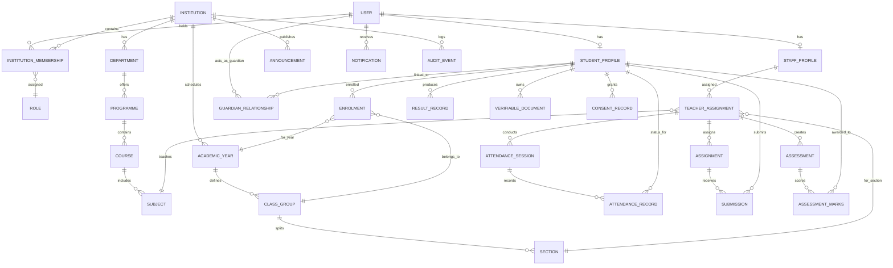

# ChhatraLekha — Entity-Relationship Model & Database Specification

**Document Version:** 1.0.0  
**Status:** Approved Target Architecture (Stage 0 Deliverable)

---

## 1. Conceptual Entity-Relationship Diagram

---

## 2. All 25 Required Domain Entities Specification

### 1. `USER`
- `user_id` (PK): Central account identifier (`USR-XXXX-XXXX`).
- `email`: Indexed unique string.
- `phone`: Nullable normalized phone number.
- `password_hash`: String (bcrypt hashed).
- `full_name`: String.
- `preferred_language`: ISO code (`en`, `hi`, `or`, `ta`, etc.).
- `is_active`: Boolean.

### 2. `INSTITUTION`
- `institution_id` (PK): Institution identifier (`INST-0421`, `SCH-DEL-001`).
- `institution_name`: String.
- `category`: Enum (`SCHOOL`, `COLLEGE`, `UNIVERSITY`, `DIRECTORATE`).
- `kind`: Enum (`K12_SCHOOL`, `POLYTECHNIC`, `ENGINEERING`, `UNIVERSITY`).
- `management_type`: Enum (`GOVERNMENT`, `GOVERNMENT_AIDED`, `PRIVATE_UNAIDED`).
- `state`: String.

### 3. `INSTITUTION_MEMBERSHIP`
- `membership_id` (PK): Unique membership identifier (`MEM-XXXX`).
- `user_id` (FK): Central user identity.
- `institution_id` (FK): Tenant context.
- `role`: Enum (`STUDENT`, `PARENT`, `TEACHER`, `SCHOOL_ADMIN`, `COLLEGE_ADMIN`, `UNIV_ADMIN`, `VERIFIER`).
- `permissions`: Array of string keys.
- `status`: Enum (`INVITED`, `ACTIVE`, `SUSPENDED`, `ALUMNI`).
- `start_date`: Date.

### 4. `ROLE_AND_PERMISSION`
- `role_id` (PK): Role name string.
- `display_name`: Human-readable label.
- `scopes`: List of permitted operation strings (`attendance:record`, `marks:enter`, etc.).
- `is_system_role`: Boolean.

### 5. `STUDENT_PROFILE`
- `student_id` (PK): Unique student profile ID (`STU-XXXX`).
- `user_id` (FK, Nullable): Linked user account once claimed.
- `student_name`: String.
- `date_of_birth`: ISO Date string (`YYYY-MM-DD`).
- `gender`: Enum (`MALE`, `FEMALE`, `OTHER`).
- `apaar_id_masked`: Masked display format (`****-****-1234`).
- `apaar_id_hmac`: SHA-256 HMAC for internal matching.
- `social_category`: Enum (`GENERAL`, `OBC`, `SC`, `ST`, `EWS`).

### 6. `STAFF_PROFILE`
- `staff_id` (PK): Staff profile ID (`STF-XXXX`).
- `user_id` (FK): Linked user account.
- `institution_id` (FK): Employer institution.
- `designation`: String (e.g. "Assistant Professor", "Senior Teacher").
- `department_id`: Nullable FK (`DEPARTMENT.department_id`).
- `is_active`: Boolean.

### 7. `GUARDIAN_RELATIONSHIP`
- `relationship_id` (PK): Relationship ID (`REL-XXXX`).
- `guardian_user_id` (FK): Parent/Guardian user ID.
- `student_id` (FK): Student profile ID.
- `relationship_type`: Enum (`FATHER`, `MOTHER`, `LEGAL_GUARDIAN`).
- `verification_status`: Enum (`PENDING`, `VERIFIED`, `REJECTED`, `REVOKED`).
- `verified_by_staff_id`: Nullable staff ID.

### 8. `ACADEMIC_YEAR`
- `year_id` (PK): Academic year ID (`AY-2024-25`).
- `institution_id` (FK): Institution identifier.
- `label`: String (`"2024-25"`).
- `start_date`: Date.
- `end_date`: Date.
- `is_current`: Boolean.

### 9. `DEPARTMENT`
- `department_id` (PK): Department ID (`DEPT-CSE`).
- `institution_id` (FK): Institution identifier.
- `name`: String (`"Computer Science & Engineering"`).
- `head_of_department_id`: Nullable staff ID.

### 10. `PROGRAMME`
- `programme_id` (PK): Programme code (`BTECH_CSE`, `CLASS_10`).
- `institution_id` (FK): Institution identifier.
- `programme_name`: String.
- `level`: Enum (`PRIMARY`, `SECONDARY`, `UG`, `PG`, `DIPLOMA`).
- `approved_intake`: Integer sanctioned cap.

### 11. `COURSE`
- `course_id` (PK): Course identifier (`CS301`).
- `programme_id` (FK): Programme identifier.
- `title`: String (`"Database Systems"`).
- `credits`: Float.

### 12. `CLASS_GROUP`
- `class_id` (PK): Class group ID (`CLS-10A`, `CLS-CSE-SEM5`).
- `institution_id` (FK): Institution identifier.
- `academic_year_id` (FK): Academic year.
- `name`: String (`"Grade 10 - Section A"`).

### 13. `SECTION`
- `section_id` (PK): Section ID (`SEC-A`).
- `class_id` (FK): Class group ID.
- `label`: String (`"A"`).

### 14. `ENROLMENT`
- `enrolment_id` (PK): Enrolment ID (`ENR-XXXX`).
- `student_id` (FK): Student profile ID.
- `institution_id` (FK): Institution identifier.
- `academic_year_id` (FK): Academic year ID.
- `programme_id` (FK): Programme code.
- `class_id` (FK): Class group ID.
- `roll_number`: String (Unique per institution/programme/year).
- `admission_quota`: Enum (`MERIT`, `MANAGEMENT`, `PMSSS`, `NRI`, `OCI`, `FN`, `TFW`).
- `status`: Enum (`ACTIVE`, `TRANSFERRED`, `GRADUATED`, `WITHDRAWN`).

### 15. `TEACHER_ASSIGNMENT`
- `assignment_id` (PK): Assignment ID (`TAS-XXXX`).
- `staff_id` (FK): Faculty ID.
- `class_id` (FK): Class group ID.
- `subject_id` (FK): Subject identifier.
- `academic_year_id` (FK): Academic year.
- `is_class_teacher`: Boolean.

### 16. `ATTENDANCE_RECORD`
- `record_id` (PK): Attendance entry ID (`ATT-REC-XXXX`).
- `session_id` (FK): Attendance session ID.
- `student_id` (FK): Student profile ID.
- `status`: Enum (`PRESENT`, `ABSENT`, `LATE`, `EXCUSED`).
- `recorded_at`: UTC Datetime.

### 17. `ASSIGNMENT`
- `assignment_id` (PK): Assignment ID (`ASG-XXXX`).
- `institution_id` (FK): Institution identifier.
- `class_id` (FK): Class group ID.
- `subject_id` (FK): Subject identifier.
- `title`: String.
- `instructions`: Text.
- `due_date`: UTC Datetime.
- `max_marks`: Float.

### 18. `SUBMISSION`
- `submission_id` (PK): Submission ID (`SUB-XXXX`).
- `assignment_id` (FK): Assignment ID.
- `student_id` (FK): Student profile ID.
- `submitted_at`: UTC Datetime.
- `file_url`: String.
- `marks_awarded`: Nullable Float.
- `feedback`: Nullable Text.

### 19. `ASSESSMENT`
- `assessment_id` (PK): Assessment ID (`ASM-XXXX`).
- `institution_id` (FK): Institution identifier.
- `class_id` (FK): Class group ID.
- `subject_id` (FK): Subject identifier.
- `title`: String (`"Mid-Term Examination"`).
- `max_marks`: Float.
- `moderation_status`: Enum (`DRAFT`, `SUBMITTED`, `MODERATED`, `APPROVED`, `PUBLISHED`).

### 20. `RESULT`
- `result_id` (PK): Result record ID (`RES-XXXX`).
- `student_id` (FK): Student profile ID.
- `academic_year_id` (FK): Academic year ID.
- `sgpa`: Float.
- `cgpa`: Float.
- `publication_token`: Opaque verification string.

### 21. `ANNOUNCEMENT`
- `announcement_id` (PK): Notice ID (`ANC-XXXX`).
- `institution_id` (FK): Institution identifier.
- `title`: String.
- `content`: Text.
- `audience`: Enum (`ALL`, `STUDENTS`, `TEACHERS`, `PARENTS`).
- `published_at`: UTC Datetime.

### 22. `NOTIFICATION`
- `notification_id` (PK): Notification ID (`NTF-XXXX`).
- `user_id` (FK): Recipient user ID.
- `title`: String.
- `message`: Text.
- `category`: Enum (`ATTENDANCE`, `EXAMINATION`, `ASSIGNMENT`, `NOTICE`).
- `is_read`: Boolean.

### 23. `DOCUMENT`
- `document_id` (PK): Document ID (`DOC-XXXX`).
- `student_id` (FK): Student profile ID.
- `document_type`: Enum (`MARKSHEET`, `DEGREE`, `BONAFIDE_CERTIFICATE`, `TRANSFER_CERTIFICATE`).
- `storage_path`: Private object storage path.
- `verification_token`: Opaque revocable cryptographic token.

### 24. `CONSENT_RECORD`
- `consent_id` (PK): Consent ID (`CST-XXXX`).
- `student_id` (FK): Student profile ID.
- `authorized_entity`: String.
- `purpose`: String.
- `granted_at`: UTC Datetime.
- `revoked_at`: Nullable UTC Datetime.

### 25. `AUDIT_EVENT`
- `event_id` (PK): Audit log ID (`AUD-XXXX`).
- `institution_id` (FK, Nullable): Associated institution context.
- `actor`: User ID or system identifier.
- `action`: String (`ENROLMENT_CREATED`, `ATTENDANCE_RECORDED`, `RESULT_PUBLISHED`).
- `subject`: Entity ID altered.
- `previous_hash`: SHA-256 hash of prior event (Hash-chained).
- `current_hash`: SHA-256 hash of this event record.
- `timestamp`: UTC Datetime.

---

## 3. Database Engine Evaluation & Migration Strategy

- **Motor MongoDB (Stages 0–10):** Maintained for rapid iterative execution and in-memory test suites without Docker dependency.
- **Abstract Repository Interface:** Applied in Stage 1 to isolate business logic from database query syntax.
- **PostgreSQL Relational Target (Stage 11):** Planned migration mapping collections to strict relational tables with Row-Level Security (`RLS`) for kernel-level tenant isolation.
