# Institute ERP Portal Integration Architecture

**Document Reference:** `docs/erp/INSTITUTE-ERP-INTEGRATION-ARCHITECTURE.md`  
**Report Identifier:** `ARCH-ERP-INT-2026-11-23`  
**Project:** ChhatraLekha Unified Education Platform  
**Architecture Pattern:** Modular Monolith + Async Database + Role-Based Subsystems  
**Target:** Schools, Colleges, Institutes and Universities across India  
**Author:** Google Antigravity  

---

## 1. Architectural Philosophy & Constraints

1. **Unified Modular Monolith:** ChhatraLekha is engineered as a single, cohesive modular monolith. Institute ERP modules (Admissions, Academics, Faculty, Attendance, Examinations, Documents) reside within the same backend codebase (`chhatralekha/app/`) and share a unified data layer.
2. **Zero Technology Fracture:** The database remains MongoDB with asynchronous `motor` drivers. No relational SQL or PostgreSQL dependencies are introduced.
3. **Strict Multi-Tenant Scoping:** Every institution's data is isolated at the repository and controller level using `institution_id` partition keys and cryptographically verified principals (`Principal.require_scope()`).
4. **Shared Component UI:** The React frontend uses a single component library governed by `DESIGN_SYSTEM.md`, ensuring identical design tokens across Student, Faculty, and Admin interfaces.

---

## 2. Integrated System Architecture Diagram

```mermaid
graph TD
    subgraph Client_Layer ["Client Presentation Layer (Vite + React)"]
        Landing["Landing & Discovery (/institutions)"]
        AuthUI["Auth & Onboarding (/login, /onboarding)"]
        StudentPortal["Student Portal (/me, /student/*)"]
        ParentPortal["Parent Portal (/parent/*)"]
        FacultyWorkspace["Faculty Workspace (/teacher/*)"]
        AdminDashboard["Institute ERP Admin (/dashboard, /setup)"]
        RegulatorPortal["State & National Regulators (/reports)"]
    end

    subgraph Gateway_Layer ["FastAPI Gateway & Security Layer"]
        CORS["CORS & Request ID Middleware"]
        AuthMiddleware["JWT Authentication & Token Rotation"]
        RBAC["Role-Based Access Control (RBAC)"]
        TenantGuard["Tenant Isolation & Scope Verification"]
        DocsGate["Production Docs Access Control (/docs, /redoc)"]
    end

    subgraph Service_Domains ["Modular Monolith Domain Services"]
        AuthSvc["Auth & Session Service"]
        OnboardingSvc["Admission & Join Request Service"]
        StudentSvc["Student Management Service"]
        AcademicSvc["Academic Hierarchy & Program Service"]
        AttendanceSvc["Attendance Engine & Anomaly Detector"]
        DocSvc["Document & OCR Ingestion Service"]
        SealSvc["Cryptographic Credential Sealing (Ed25519)"]
        CommSvc["Announcements & Notifications Gateway"]
    end

    subgraph Persistence_Layer ["Async Database Layer (Motor / MongoDB)"]
        InstitutionsCol[("institutions")]
        UsersCol[("users & sessions")]
        StudentsCol[("students")]
        JoinRequestsCol[("join_requests")]
        AcademicUnitsCol[("academic_units & terms")]
        AttendanceCol[("attendance_records")]
        CredentialsCol[("credentials & seals")]
        AuditCol[("audit_events")]
    end

    Client_Layer --> Gateway_Layer
    Gateway_Layer --> Service_Domains
    Service_Domains --> Persistence_Layer
```

---

## 3. Core Module Boundaries & Interfaces

### 3.1 Institute Administration & Academic Hierarchy (`app/api/academic.py`, `schools.py`, `institutions.py`)
* **Responsibility:** Manages institution profiles, academic terms, departments, school grades, college programs, sections, and faculty assignments.
* **Entities:**
  * `InstitutionDoc`: metadata, code, type (`SCHOOL`, `COLLEGE`, `UNIVERSITY`, `POLYTECHNIC`), board/affiliation, address.
  * `DepartmentDoc`: `department_id`, `institution_id`, `name`, `code`, `head_of_department_id`.
  * `AcademicUnitDoc`: `unit_id`, `institution_id`, `unit_type` (`CLASS` vs `DEGREE_PROGRAM`), `name`, `sections`, `semesters`.
* **Tenant Isolation:** Enforced via `filter = {"institution_id": principal.institution_id}`.

### 3.2 Admission Processing & Student Onboarding (`app/api/onboarding.py`, `students.py`)
* **Responsibility:** Ingests self-service applicant submissions, validates target institution academic catalog, stages join requests for administrative approval, and promotes approved applicants to full student records.
* **Workflow:**
  1. Applicant completes 7-step wizard selecting verified institution and course/grade (`POST /api/onboarding/join-request`).
  2. Join request persisted with `status: "PENDING_APPROVAL"`.
  3. Institute administrator reviews pending list (`GET /api/onboarding/join-requests`).
  4. Administrator approves applicant (`POST /api/onboarding/join-requests/{id}/approve`):
     - Mints or verifies APAAR ID (Luhn/Verhoeff validation).
     - Inserts active record into `students` collection.
     - Upgrades user role from `applicant` to `student`.
     - Logs critical audit trail entry `STUDENT_ADMISSION_APPROVED`.

### 3.3 Document Management & Verification (`app/api/upload.py`, `verify.py`)
* **Responsibility:** Secure intake, virus/format scanning, OCR parsing, and administrative verification of identity proofs, transcripts, and certificates.
* **Storage Strategy:** Hashed file storage with cryptographic SHA-256 integrity verification. Metadata tracks `verification_status` (`PENDING`, `VERIFIED`, `REJECTED`).

---

## 4. Multi-Tenant Isolation & Access Control Rules

1. **Explicit Principal Scope:** The authenticated caller's JWT carries `institution_id` and `role`. Any operation affecting institutional entities must execute `principal.require_scope(target_institution_id)`.
2. **Zero Cross-Tenant Leakage:** If an administrative user specifies an `institution_id` query parameter different from their active token scope, the API strictly rejects the request with HTTP 403 Forbidden.
3. **Multi-Role Principals:** Users holding roles in multiple institutions (e.g. visiting faculty or parents with children across institutions) must switch active context via `/api/auth/switch-context`, issuing an explicitly scoped session.
4. **Directorate Privileges:** State and national regulator administrators (`state_admin`, `aicte_admin`, `national_admin`) possess cross-institutional read access restricted to aggregated, anonymized, or explicitly sanctioned audit reporting endpoints.
