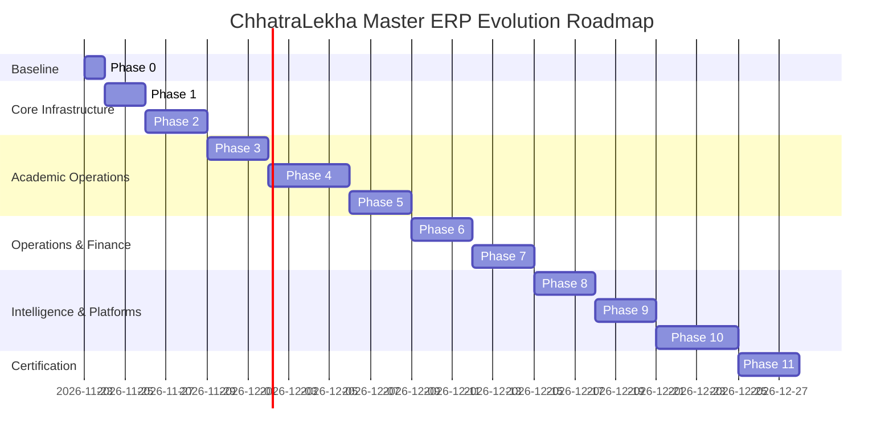

# ChhatraLekha — Master ERP Integration & Platform Evolution Roadmap

**Document Reference:** `docs/roadmap/ERP-INTEGRATION-ROADMAP.md`  
**Version:** 1.0.0  
**Authority:** Master Roadmap Directive for Phased Platform Evolution  
**Repository:** [ChhatraLekha](https://github.com/kumaribaishnabidas/ChhatraLekha.git)  
**Last Updated:** 2026-11-23  

---

## 1. Roadmap Architecture & Priority Governance

To evolve ChhatraLekha into a national-scale academic ERP without destabilizing verified systems, all development is ordered strictly according to the **12 Core Governance Priorities**:

```
[1. Security] ➔ [2. Data Integrity] ➔ [3. Authentication & Authorization] ➔
[4. Institutional Isolation] ➔ [5. Student Onboarding] ➔ [6. Attendance Reliability] ➔
[7. Academic Records] ➔ [8. AI/RAG Reliability] ➔ [9. Platform Stability] ➔
[10. Mobile & Desktop Support] ➔ [11. Production Deployment] ➔ [12. Accessibility & Localization]
```

### Governing Execution Rules:
1. **Incremental Evolution:** No feature is built on an isolated scaffold; all changes extend the existing modular monolith.
2. **Read-Only Gate (Phase 0):** Zero implementation code is written in Phase 0.
3. **Continuous Verification:** Every phase concludes with automated test suites (`pytest`, `vitest`, `gradlew`), governance checks (`verify_project_docs.py`), and a formal Task Audit Report.
4. **Approval Required:** Commits, pushes, branch merges, and deployments require explicit human authorization.

---

## 2. Phased Implementation Roadmap (Phases 0 through 11)



---

### Phase 0: Master Audit & Governance Baseline (COMPLETED)
- **Objective:** Establish authoritative baseline inventory, verify the 4 governance documents, audit all 24 ERP domains, and produce the architectural and roadmap blueprints.
- **Deliverables:**
  - `docs/audits/CHHATRALEKHA-ERP-INTEGRATION-AUDIT.md`
  - `docs/architecture/ERP-MODULE-INTEGRATION-MAP.md`
  - `docs/roadmap/ERP-INTEGRATION-ROADMAP.md`
- **Verification:** `python scripts/verify_project_docs.py` (Exit code 0).
- **Exit Criteria:** Full inventory complete with zero unapproved code modifications.

---

### Phase 1: Attendance & Baseline Reconciliation (PRIORITY: P0 / DATA INTEGRITY)
- **Objective:** Reconcile the 7 commits from `origin/feature/stage-0-9-attendance` into `main` after human review.
- **Scope & Deliverables:**
  - Fast-forward merge `4f33c8b` (*fix(attendance): harden session flow and repair unique index creation*).
  - Integrate unique compound index `{"institution_id": 1, "academic_unit_id": 1, "date": 1, "session_type": 1}`.
  - Integrate labeled synthetic anomaly evaluation benchmark (`acbae6a`).
  - Integrate offline grounded RAG retrieval pipeline (`d9eb96d`).
- **Dependencies:** Human review and merge authorization.
- **Test Commands:**
  ```bash
  python -m pytest chhatralekha/tests/test_stage_0_9_attendance.py
  python -m pytest chhatralekha/tests/test_anomaly_engine.py
  ```
- **Exit Criteria:** 100% passing tests with zero merge regressions on `main`.

---

### Phase 2: Academic Hierarchy & Universal Onboarding (PRIORITY: P1 / ONBOARDING)
- **Objective:** Unify school and college institutional hierarchies and extend the student onboarding wizard to full self-service registration.
- **Scope & Deliverables:**
  - Backend: Extend `chhatralekha/app/api/schools.py` and `institutions.py` to support departments, branches, and multi-campus grouping.
  - Frontend: Connect `StudentAcademicSelectionWizard.jsx` to real self-service registration (`POST /api/auth/register`).
  - Validation: Enforce strict institution-scoped class/program checking in production registration.
- **Dependencies:** Phase 1 baseline.
- **Test Commands:**
  ```bash
  python -m pytest chhatralekha/tests/test_demo_academic_context.py
  npm.cmd test -- --run src/test/StudentAcademicSelectionWizard.test.jsx
  ```
- **Exit Criteria:** Both school grades (1-12) and collegiate programs (UG/PG/Diploma) onboard smoothly without static hardcoding.

---

### Phase 3: Timetable & Automated Conflict Engine (PRIORITY: P1 / OPERATIONS)
- **Objective:** Implement automated scheduling conflict detection for faculty, classrooms, and courses.
- **Scope & Deliverables:**
  - Backend: Build conflict detection algorithm in `app/api/academic.py` (`POST /api/academic/timetable/validate`).
  - Rules: Detect faculty double-booking, classroom room collisions, and invalid timeslot overlaps.
  - Frontend: Visual timetable conflict indicators on `AcademicSetupPage.jsx` and `TeacherWorkspacePage.jsx`.
- **Dependencies:** Phase 2 institutional models.
- **Test Commands:**
  ```bash
  python -m pytest chhatralekha/tests/test_timetable_conflicts.py
  ```
- **Exit Criteria:** Server rejects overlapping schedule mutations with HTTP 409 Conflict.

---

### Phase 4: Online Examination & CBT Question Bank (PRIORITY: P1 / ACADEMIC)
- **Objective:** Add online Computer-Based Testing (CBT) MCQ question authoring, student attempt timing, and automated grading.
- **Scope & Deliverables:**
  - Backend: Extend `app/api/assessments.py` with `/questions`, `/attempts`, and `/submit`.
  - Timer: Server-controlled attempt countdown with auto-submission upon window expiry.
  - Grading: Instant automated scoring for MCQ questions with moderation locks for subjective components.
  - Frontend: Student examination taking interface (`ExamTakePage.jsx`) with responsive layout and question navigation palette.
- **Dependencies:** Phase 2 student enrollment.
- **Test Commands:**
  ```bash
  python -m pytest chhatralekha/tests/test_exam_engine.py
  ```
- **Exit Criteria:** Student attempts prevent duplicate submissions and enforce strict deadline cutoffs.

---

### Phase 5: Academic Records, Grading & Transcripts (PRIORITY: P1 / RECORDS)
- **Objective:** Deliver institutional grading policies, transcript generation, and printable report cards.
- **Scope & Deliverables:**
  - Backend: Configurable GPA/grading policy resolver (10-point scale, percentage, Letter Grade).
  - Transcripts: PDF report card generation via `reportlab` with embedded Ed25519 QR seal.
  - Frontend: Downloadable transcript view on `StudentResultsPage.jsx`.
- **Dependencies:** Phase 4 assessments.
- **Test Commands:**
  ```bash
  python -m pytest chhatralekha/tests/test_transcripts.py
  ```
- **Exit Criteria:** PDF transcripts compile cleanly with valid, verifiable cryptographic QR codes.

---

### Phase 6: Multi-Channel Communication Gateway (PRIORITY: P2 / COMMUNICATION)
- **Objective:** Build centralized campus notification hub supporting In-App, Email, SMS, and WhatsApp Business.
- **Scope & Deliverables:**
  - Backend: `app/api/comm.py` dispatcher with channel adapters:
    - In-App: MongoDB `notifications` collection with WebSocket / polling.
    - Email: SMTP / AWS SES adapter with verified HTML templates.
    - SMS: DLT-compliant Indian SMS provider adapter (Msg91 / Twilio).
    - WhatsApp: Meta Cloud WhatsApp Business API webhook & template dispatcher.
  - Frontend: Unified `CommunicationHubPage.jsx` with channel selector, template preview, and delivery logs.
- **Dependencies:** Phase 2 role scopes.
- **Test Commands:**
  ```bash
  python -m pytest chhatralekha/tests/test_communication_hub.py
  ```
- **Exit Criteria:** Mock dispatchers pass all tests; live dispatchers remain dormant until operator configures API credentials.

---

### Phase 7: Fees & Financial Administration ERP (PRIORITY: P2 / FINANCIAL)
- **Objective:** Implement institution-configurable fee structures, student fee ledgers, and synthetic payment receipts.
- **Scope & Deliverables:**
  - Backend: `app/api/fees.py` module with double-entry accounting ledgers (`fee_structures`, `fee_accounts`, `fee_receipts`).
  - Security: Strict prototype mode with synthetic payment gateway; zero live card numbers stored.
  - Frontend: `FeesManagementPage.jsx` for admins and `StudentFeeDuesPage.jsx` for students/parents.
- **Dependencies:** Phase 2 student accounts.
- **Test Commands:**
  ```bash
  python -m pytest chhatralekha/tests/test_fee_engine.py
  ```
- **Exit Criteria:** Balance calculations are verified mathematically with immutable audit logging.

---

### Phase 8: Role-Specific ERP Dashboards & Analytics (PRIORITY: P2 / ANALYTICS)
- **Objective:** Polish and enrich dedicated dashboards across Student, Faculty, School, College, and University tiers.
- **Scope & Deliverables:**
  - Student: Today's schedule, attendance progress bar, upcoming tests, pending fee notices.
  - Faculty: Classroom attendance shortcut, grading queue, timetable matrix.
  - Admin: Real-time attendance percentage, intake capacity meters, fee collection totals, pending anomaly cases.
- **Dependencies:** Phases 3, 4, 5, 7.
- **Test Commands:**
  ```bash
  npm.cmd test -- --run src/test/Dashboards.test.jsx
  ```
- **Exit Criteria:** Real-time data binds cleanly with zero hardcoded placeholder values.

---

### Phase 9: AI Assistant & Anomaly Detection Grounding (PRIORITY: P2 / AI)
- **Objective:** Deepen AI conversational assistance with full ERP retrieval and expand anomaly detection to attendance and fee patterns.
- **Scope & Deliverables:**
  - AI Assistant: Ground queries in real ERP policies (e.g. "What is my attendance in Physics?", "When is the next term exam?").
  - Anomaly Engine: Layer 11 (abnormal mass attendance absences) and Layer 12 (fee concession quota breaches).
- **Dependencies:** Phases 1, 3, 5, 7.
- **Test Commands:**
  ```bash
  python -m pytest chhatralekha/tests/test_ai_grounding.py
  ```
- **Exit Criteria:** AI assistant answers factually from authorized student records with zero cross-tenant leakage.

---

### Phase 10: Android & Linux Desktop Cross-Platform Sync (PRIORITY: P2 / PLATFORMS)
- **Objective:** Synchronize new ERP capabilities across Android and Linux desktop clients.
- **Scope & Deliverables:**
  - Android: Add Compose screens for Timetable, Examinations, and Results with Room offline sync.
  - Linux Desktop: Merge `origin/feature/linux-desktop` into monorepo `desktop/` directory and package Electron build.
- **Dependencies:** Phases 3, 4, 5.
- **Test Commands:**
  ```bash
  cd android && ./gradlew test
  ```
- **Exit Criteria:** Android unit tests pass (>= 204 tests); Linux desktop boots cleanly.

---

### Phase 11: Security Hardening, Regression Testing & Release Readiness (PRIORITY: P0 / RELEASE)
- **Objective:** Comprehensive security audit, WCAG 2.1 AA accessibility audit, full regression testing, and production packaging.
- **Scope & Deliverables:**
  - Full automated regression test execution across backend, frontend, and mobile.
  - Run `scripts/verify_project_docs.py` to certify governance compliance.
  - Update `docs/audits/` and publish release notes.
- **Dependencies:** All previous phases.
- **Test Commands:**
  ```bash
  python -m pytest chhatralekha/tests/
  npm.cmd test -- --run
  python scripts/verify_project_docs.py
  ```
- **Exit Criteria:** 100% test pass rate, 0 open security vulnerabilities, and human sign-off.
