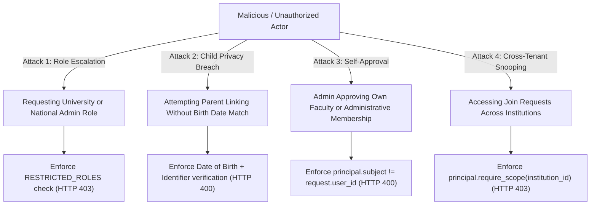

# Security and Threat Model Analysis
## Institution Membership and Onboarding Security

**Platform:** ChhatraLekha  
**Subsystem:** Identity, RBAC, and Tenant Isolation  
**Status:** Enforced and Verified  

---

### 1. Threat Model and Attack Surface

The user onboarding and institution joining workflow introduces several critical threat vectors that require deterministic server-side enforcement:



---

### 2. Security Invariants and Mitigations

#### Invariant 1: Prevention of Self-Service Privilege Escalation
- **Threat:** An adversary calls `POST /api/onboarding/join-request` or `POST /api/onboarding/complete` with payload specifying privileged roles (`national_admin`, `aicte_admin`, `university_admin`, `state_admin`, `platform_operator`).
- **Mitigation:**
  The server explicitly maintains a `RESTRICTED_ROLES` set:
  ```python
  RESTRICTED_ROLES = {
      "national_admin",
      "platform_operator",
      "aicte_admin",
      "university_admin",
      "state_admin",
      "district_admin",
      "regulator_admin",
  }
  ```
  If any self-service request specifies a role in this set, the backend rejects the request immediately with HTTP 403 Forbidden:
  `Security violation: Privileged role '<role>' cannot be requested through self-service.`

#### Invariant 2: Cryptographic Parent-Child Verification and Minor Privacy
- **Threat:** An unauthenticated or unrelated user attempts to link themselves to a student's record using public roll numbers or guessing an APAAR ID, intending to exfiltrate academic performance, attendance, and home contact details.
- **Mitigation:**
  - The API requires both the student identifier and exact date of birth (`student_dob`).
  - The record is verified against `db["students"]`. If `matched_student.get("date_of_birth") != payload.student_dob`, the request is rejected with HTTP 400 Bad Request.
  - Successful submissions create a pending entry in `guardian_relationships` with status `PENDING`.
  - As proven in Stage 0.3 remediation (`SEC-AUTH-03`), parent portal endpoints verify `status == "VERIFIED"` before exposing any student data. Unverified or pending relationships never leak academic records.

#### Invariant 3: Prevention of Administrative Self-Approval
- **Threat:** A user with administrator credentials at an institution creates a membership request to escalate their own permissions or assign themselves faculty roles without dual authorization.
- **Mitigation:**
  In `POST /api/institutions/{institution_id}/join-requests/{request_id}/review`:
  ```python
  if join_req.get("user_id") == principal.subject:
      raise HTTPException(
          status_code=status.HTTP_400_BAD_REQUEST,
          detail="Security violation: Administrators cannot approve their own join requests.",
      )
  ```
  The endpoint strictly enforces separation of duties; another authorized institutional administrator must review and approve the request.

#### Invariant 4: Tenant-Isolated Join Request Queues
- **Threat:** An administrator from Institution A queries or reviews membership requests belonging to Institution B.
- **Mitigation:**
  Both `GET /api/institutions/{institution_id}/join-requests` and `POST /api/institutions/{institution_id}/join-requests/{request_id}/review` execute `principal.require_scope(institution_id)`.
  If the administrator's token does not possess scope for the target institution, the platform denies access with HTTP 403 Forbidden.

#### Invariant 5: Idempotency and Duplicate Request Prevention
- **Threat:** A user spams the join request endpoint, creating dozens of identical pending records or attempting to trigger race conditions.
- **Mitigation:**
  The server performs an atomic query for existing pending requests:
  ```python
  existing_pending = await db["membership_requests"].find_one({
      "user_id": principal.subject,
      "institution_id": payload.institution_id,
      "requested_role": requested_role_str,
      "status": "PENDING",
  })
  if existing_pending:
      raise HTTPException(
          status_code=status.HTTP_409_CONFLICT,
          detail="You already have a pending join request for this role at this institution.",
      )
  ```

---

### 3. Tamper-Evident Audit Logging

Every critical event in the onboarding and institutional membership lifecycle emits a structured, immutable audit log entry into the `audit_events` collection:

| Event Action | Logged Fields | Audit Category |
| :--- | :--- | :--- |
| `ONBOARDING_UPDATE_PROFILE` | Actor ID, Role, Full Name, Language, Client IP | `ONBOARDING` |
| `SUBMIT_MEMBERSHIP_JOIN_REQUEST` | Actor ID, Request ID, Target Institution ID, Role, Client IP | `ONBOARDING` |
| `REVIEW_MEMBERSHIP_REQUEST` | Admin Subject, Applicant User ID, Decision, Notes, Client IP | `MEMBERSHIP` |
| `COMPLETE_ONBOARDING` | Actor ID, Selected Role, Target Dashboard, Client IP | `ONBOARDING` |
