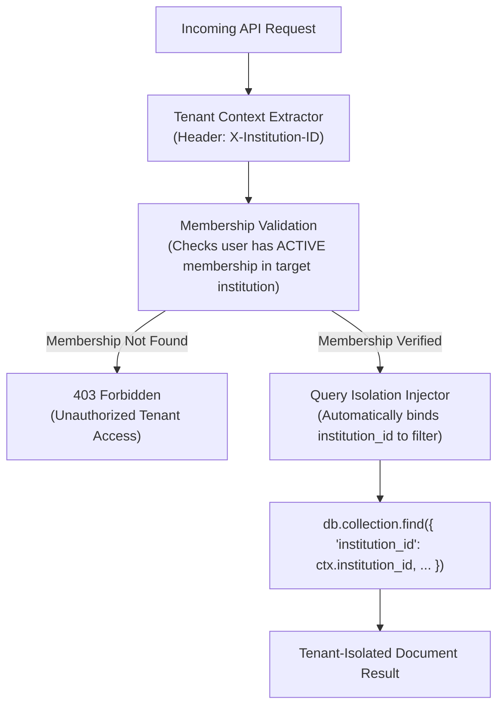

# ChhatraLekha — Tenant Isolation & Multi-Institution Security

**Document Version:** 1.0.0  
**Status:** Approved Target Architecture (Stage 0 Deliverable)

---

## 1. Multi-Tenant Architecture & Threat Model

ChhatraLekha serves schools, colleges, and universities across India on a shared infrastructure pool. The multi-tenant security model guarantees that:

1. **Zero Cross-Tenant Leakage:** An administrator, teacher, student, or parent from Institution A can never read, modify, or infer records belonging to Institution B.
2. **Backend Enforced:** Frontend hiding of links or buttons is treated as UI convenience; 100% of tenant boundaries are validated on the backend.
3. **No Unrestricted Super-Admins in Tenant Data:** Even national / AICTE platform administrators can only access aggregate regulatory metrics; they cannot inspect private student communications, health records, or confidential complaints without an authorized warrant/order.



---

## 2. Multi-Tenant Enforcement Pattern

### 2.1 Repository-Level Tenant Scoping
All repository query helpers automatically accept `TenantContext`:

```python
class BaseTenantRepository:
    def __init__(self, collection: Any, tenant: TenantContext):
        self._col = collection
        self._tenant_id = tenant.institution_id

    def _scope_filter(self, query: dict) -> dict:
        scoped = dict(query)
        scoped["institution_id"] = self._tenant_id
        return scoped

    async def find_one(self, query: dict) -> Doc | None:
        return await self._col.find_one(self._scope_filter(query))
```

### 2.2 Testing Cross-Tenant Isolation
Automated test suites must instantiate at least two synthetic institutions (`INST-ALPHA` and `INST-BETA`):
- Assert that a valid token from `INST-ALPHA` receives `403 Forbidden` when attempting to access `INST-BETA` endpoints.
- Assert that a student listing query in `INST-ALPHA` never returns rows from `INST-BETA`.

---

## 3. Data Protection & DPDP Act 2023 Compliance

1. **Child Data Protection (Section 9):**
   - For minors (<18 years), verified parental consent is required before sharing academic records externally.
   - Zero behavioural tracking, profiling, or targeted advertisements are permitted.
2. **Confidential Grievance Siloing:**
   - Complaints marked `CONFIDENTIAL` or `HARASSMENT` are physically restricted to designated anti-ragging / grievance committee members and excluded from regular administrative queries.
3. **APAAR Masking:**
   - Raw 12-digit APAAR numbers are permanently masked (`****-****-1234`) in web views and public APIs.
   - External verification relies solely on opaque, revocable cryptographic tokens (`/verify/t/{token}`).

