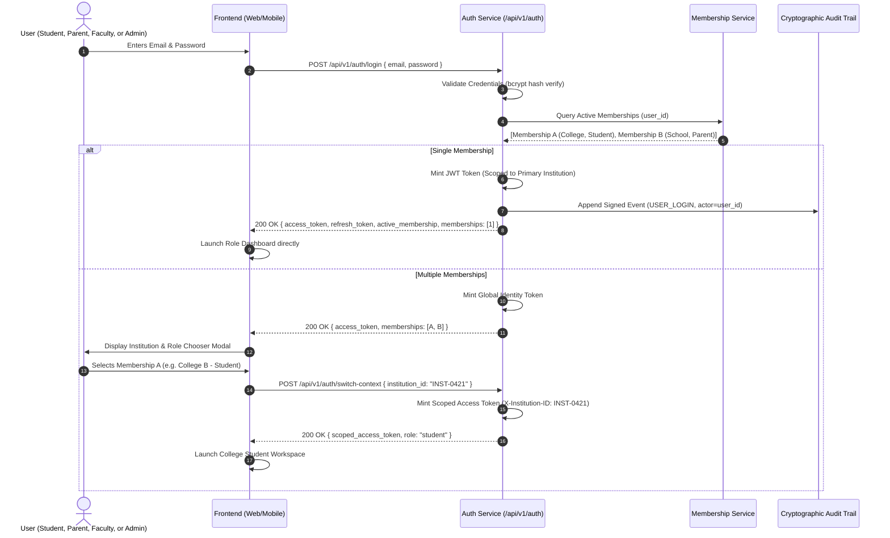

# ChhatraLekha — Authentication & Multi-Membership Workflow

**Document Version:** 1.0.0  
**Status:** Approved Target Architecture (Stage 0 Deliverable)

---

## 1. Authentication & Context Switching Sequence

---

## 2. Key Lifecycle Operations

### 2.1 User Registration & Activation
1. **Self-Registration:** New users can sign up with email and phone verification. Upon creation, a central `User` identity is established with zero institutional memberships.
2. **Claim Code Activation:** When an educational institution imports or enrols a student, it generates a single-use claim code. The student inputs this claim code during onboarding, linking their central `User` account to their pre-created `StudentProfile` and activating their `InstitutionMembership`.

### 2.2 Token Refresh & Expiration
- Access tokens expire every **15 minutes**.
- The client silently issues `POST /api/v1/auth/refresh` using the HTTP-only secure refresh token (valid for 7 days).
- If the user's membership status in that institution has been suspended or revoked, refresh is immediately rejected (`401 Unauthorized`), terminating session access.

### 2.3 Secure Logout & Session Revocation
- When `POST /api/v1/auth/logout` is called:
  1. The client clears local stores (Keychain on iOS, EncryptedSharedPreferences on Android, memory in Web).
  2. The server records the token JTI in `revoked_credentials`.
  3. A cryptographic audit event (`USER_LOGOUT`) is permanently appended.

