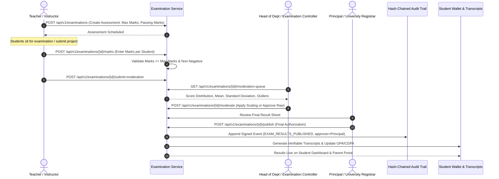

# ChhatraLekha — Examination & Result Moderation Workflow

**Document Version:** 1.0.0  
**Status:** Approved Target Architecture (Stage 0 Deliverable)

---

## 1. Multi-Stage Assessment & Moderation Sequence

---

## 2. Integrity Safeguards

1. **Role-Segregated Moderation:**
   - Teachers cannot independently publish final semester grades without Departmental / Controller approval.
   - AI tools may suggest statistical summaries (bell curve, standard deviation), but **AI must never automatically approve or publish academic results**.
2. **Immutable Result Records:**
   - Published transcripts receive an opaque SHA-256 verification token.
   - Any post-publication grade correction requires a formal Academic Council review ticket and produces a new sealed transcript version (`v2`), preserving `v1` in the audit ledger.
