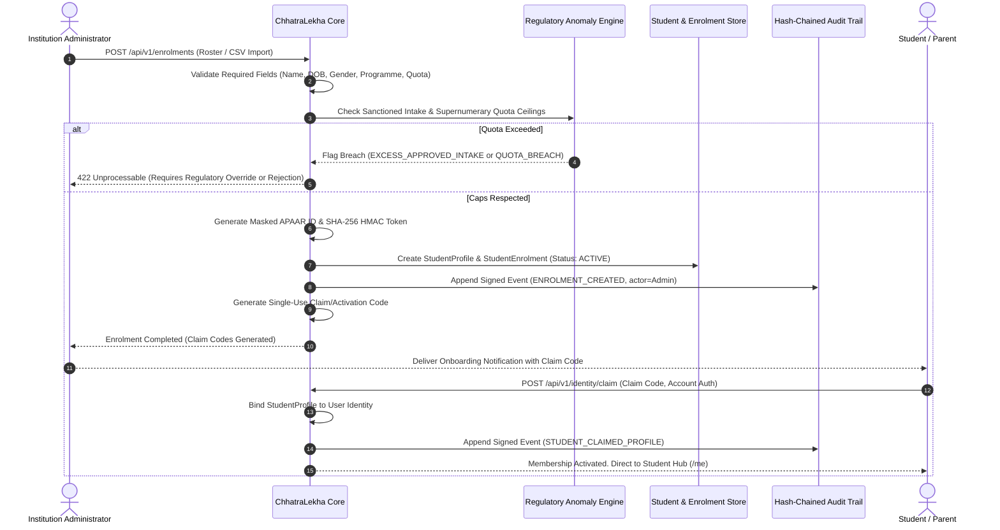

# ChhatraLekha — Student Enrolment Workflow

**Document Version:** 1.0.0  
**Status:** Approved Target Architecture (Stage 0 Deliverable)

---

## 1. End-to-End Enrolment Sequence

---

## 2. Business Rules & Safeguards

1. **Intake Cap Compliance:**
   - Every programme specifies `approved_intake` and supernumerary caps (NRI 5%, OCI/FN 15%, TFW 5%, PMSSS cap).
   - Enrolments beyond the approved capacity are halted unless explicitly granted an authorized regulatory waiver.
2. **Duplicate APAAR Protection:**
   - When a student enrolment is submitted, the backend computes `match_token(apaar_id)`.
   - If the same match token exists in another active higher education institution for the same academic year, a `DUPLICATE_CROSS_COLLEGE` anomaly is automatically flagged.
3. **Roll Number Uniqueness:**
   - Roll numbers must be strictly unique within the composite tuple `(institution_id, programme_id, academic_year)`.

